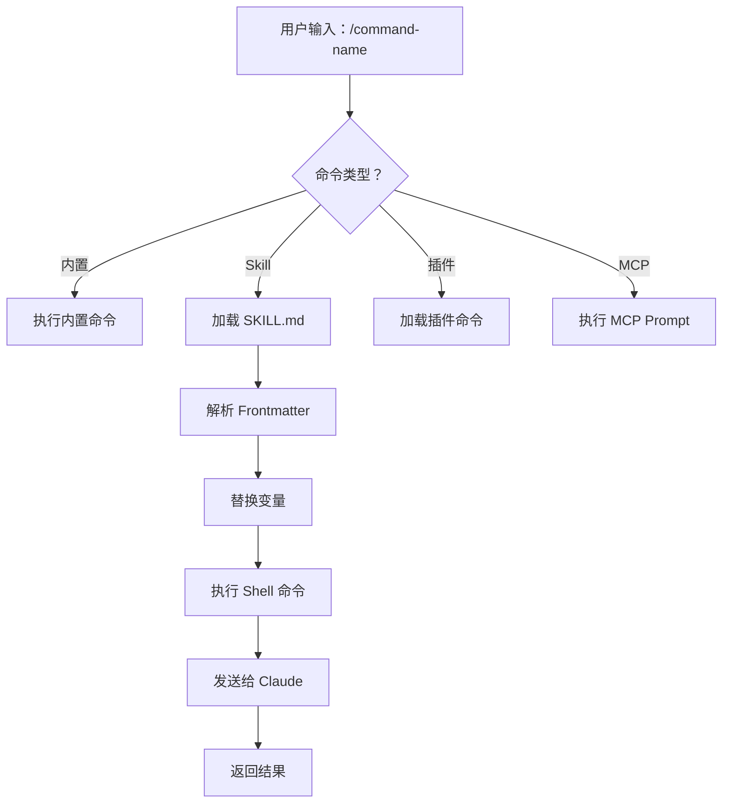
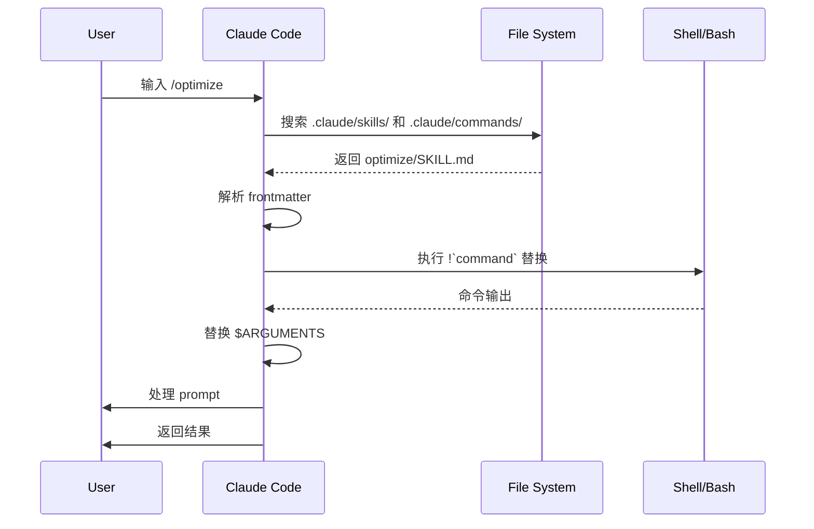

<picture>
  <source media="(prefers-color-scheme: dark)" srcset="../../resources/logos/claude-howto-logo-dark.svg">
  
</picture>

# راهنمای Slash Commandها

## مرور کلی

Slash commandها shortcutهایی هستند که در یک session تعاملی Claude برای کنترل رفتار استفاده می‌کنید و به چند دسته تقسیم می‌شوند:

- **commandهای built-in**: همراه Claude Code ارائه می‌شوند، مانند `/help`، `/clear`، `/model`
- **Skillها**: commandهایی که خودتان تعریف می‌کنید بر اساس فایل‌های `SKILL.md`، مانند `/optimize`، `/pr`
- **commandهای plugin**: از pluginهای نصب‌شده، مانند `/frontend-design:frontend-design`
- **MCP promptها**: از MCP serverها، مانند `/mcp__github__list_prs`

> **نکته**: custom slash commandها اکنون در Skillها ادغام شده‌اند. `.claude/commands/` همچنان کار می‌کند، اما اکنون استفاده از `.claude/skills/` توصیه می‌شود. هر دو shortcut `/command-name` ایجاد می‌کنند. برای reference کامل [راهنمای Skills](../03-skills/README.md) را ببینید.

## مرجع سریع commandهای built-in

Claude Code در حال حاضر ۵۵+ command built-in و حدود ۲۰ Skill built-in ارائه می‌دهد. می‌توانید `/` را در Claude Code تایپ کنید تا همه را ببینید، یا پس از `/` حروف را تایپ کنید تا فیلتر شوند.

| command | عملکرد |
|---------|---------|
| `/add-dir <path>` | افزودن working directory |
| `/agents` | دیگر یک command قابل استفاده نیست: wizard تعاملی در v2.1.198 حذف شد، و از v2.1.281 `/agents` دیگر در منوی `/` یا `/help` نمایش داده نمی‌شود — تایپ آن فقط جایی که wizard رفته را توضیح می‌دهد. بگذارید Claude subagent بسازد یا مدیریت کند، یا فایل‌ها را مستقیماً در `.claude/agents/` ویرایش کنید |
| `/branch [name]` | switch به یک کپی از مکالمه فعلی، مکالمه اصلی بدون تغییر |
| `/fork [prompt]` | کپی کردن مکالمه فعلی به یک **نشست background** جدید که می‌توانید در آن به کار ادامه دهید؛ از این لحظه به بعد مستقل هستند، و کپی یک خط در `claude agents` می‌گیرد (v2.1.212+) |
| `/subtask <task>` | spawn یک **forked subagent** که مکالمه کامل را inherit می‌کند و task را اجرا می‌کند، شما می‌توانید به کار ادامه دهید؛ وقتی task تمام شود نتیجه به این مکالمه برمی‌گردد (v2.1.212+) |
| `/btw <question>` | سؤال اضافی، بدون نوشتن در history |
| `/chrome` | پیکربندی یکپارچه‌سازی مرورگر Chrome |
| `/clear` | پاک کردن مکالمه (alias: `/reset`، `/new`) |
| `/color [color\|default]` | تنظیم رنگ prompt bar |
| `/compact [instructions]` | فشرده‌سازی مکالمه، با دستورالعمل‌های focus اختیاری |
| `/config` | باز کردن تنظیمات (alias: `/settings`) |
| `/context` | visualization grid رنگی از مصرف context |
| `/copy [N]` | کپی پاسخ assistant به clipboard؛ `w` در فایل می‌نویسد |
| `/cost` | مشاهده آمار مصرف token |
| `/desktop` | ادامه در desktop app (alias: `/app`) |
| `/diff` | diff تعاملی تغییرات uncommitted |
| `/doctor` | بررسی سلامت نصب |
| `/effort [low\|medium\|high\|max\|auto]` | تنظیم شدت reasoning؛ `max` نیازمند Opus 4.6 |
| `/exit` | خروج از REPL (alias: `/quit`) |
| `/export [filename]` | export مکالمه فعلی به فایل یا clipboard |
| `/extra-usage` | پیکربندی extra usage برای rate limitها |
| `/fast [on\|off]` | toggle حالت fast |
| `/feedback` | ارسال feedback |
| `/help` | نمایش help |
| `/hooks` | مشاهده پیکربندی hook |
| `/ide` | مدیریت یکپارچه‌سازی IDE |
| `/init` | مقداردهی اولیه `CLAUDE.md`، با `CLAUDE_CODE_NEW_INIT=1` برای flow تعاملی |
| `/insights` | تولید گزارش تحلیل نشست |
| `/install-github-app` | پیکربندی GitHub Actions app |
| `/install-slack-app` | نصب Slack app |
| `/keybindings` | باز کردن پیکربندی keybinding |
| `/login` | switch حساب Anthropic |
| `/logout` | خروج از حساب Anthropic فعلی |
| `/mcp` | مدیریت MCP serverها و OAuth |
| `/memory` | ویرایش `CLAUDE.md`، toggle auto memory |
| `/mobile` | تولید QR code برای موبایل (alias: `/ios`، `/android`) |
| `/model [model]` | انتخاب مدل، با arrowها برای تنظیم effort |
| `/output-style [name]` | لیست و switch output style (در v2.1.91 حذف، در v2.1.269 دوباره اضافه شد). بدون آرگومان، همه styleها را لیست می‌کند و فعلی را مشخص می‌کند. در نشست‌های headless و Remote Control کار می‌کند؛ انتخاب در `.claude/settings.local.json` ذخیره می‌شود |
| `/passes` | اشتراک یک هفته استفاده رایگان Claude Code |
| `/permissions` | مشاهده یا به‌روزرسانی permissionها (alias: `/allowed-tools`) |
| `/plan [description]` | ورود به planning mode |
| `/plugin` | مدیریت pluginها |
| `/pr-comments [PR]` | دریافت commentهای PR گیت‌هاب |
| `/privacy-settings` | تنظیمات privacy (فقط Pro/Max) |
| `/release-notes` | مشاهده changelog |
| `/reload-plugins` | reload کردن pluginهای فعلی. از v2.1.221، اکثر نصب‌ها بلافاصله اعمال می‌شوند، فقط وقتی خلاصه نصب می‌گوید `Run /reload-plugins to activate.` باید اجرا شود |
| `/remote-control` | remote control از claude.ai (alias: `/rc`) |
| `/remote-env` | پیکربندی default remote environment |
| `/rename [name]` | تغییر نام نشست |
| `/resume [session]` | resume مکالمه (alias: `/continue`) |
| `/review [low\|medium\|high\|xhigh\|max\|ultra] [--fix] [--comment] [pr#\|branch\|path]` | alias `/code-review` (v2.1.223): بررسی diff فعلی، یا PR number، branch یا path داده‌شده — مثلاً `/review 1234`. همان سطوح effort و flagها را می‌پذیرد. اگر سطح مشخص نشود، آخرین سطح `low`–`max` واردشده reuse می‌شود |
| `/rewind` | rewind مکالمه و/یا کد (alias: `/checkpoint`) |
| `/sandbox` | toggle حالت sandbox |
| `/schedule [description]` | ایجاد/مدیریت taskهای scheduled |
| `/security-review` | تحلیل آسیب‌پذیری‌های امنیتی در branch |
| `/skills` | لیست Skillهای موجود |
| `/stats` | visualization استفاده روزانه، نشست‌ها و streakها |
| `/status` | نمایش نسخه، مدل، حساب |
| `/statusline` | پیکربندی status line |
| `/tasks` | لیست/مدیریت background taskها |
| `/terminal-setup` | پیکربندی shortcutهای ترمینال |
| `/theme` | تغییر theme رنگ |
| `/voice` | toggle voice input press-to-talk |

### Skillهای built-in

Skillهای زیر همراه Claude Code ارائه می‌شوند و مانند slash command فراخوانی می‌شوند:

| Skill | عملکرد |
|-------|---------|
| `/batch <instruction>` | orchestrate تغییرات موازی در مقیاس بزرگ با worktreeها |
| `/claude-api` | بارگذاری reference Claude API برای نوشتن کد در زبان پروژه |
| `/debug [description]` | فعال کردن debug logging |
| `/loop [interval] [prompt]` | تکرار یک prompt در فواصل ثابت |
| `/simplify [focus]` | بررسی کیفیت کد فایل‌های تغییریافته |

### commandهای منسوخ‌شده

| command | وضعیت |
|---------|--------|
| `/vim` | از v2.1.92 حذف شد؛ از `/config → Editor mode` استفاده کنید |

### تغییرات اخیر

- `/fork` و `/subtask` در **v2.1.212** نقش خود را swap کردند. `/fork` اکنون کپی مکالمه به یک نشست background مستقل است؛ رفتار forked subagent قبلی به command جدید `/subtask` منتقل شد. تاریخچه: v2.1.77–v2.1.161 `/fork` alias `/branch` بود؛ v2.1.161–v2.1.211 آن forked subagent (رفتار فعلی `/subtask`) را راه‌اندازی می‌کرد. `/subtask` وقتی agent view بسته است موجود نیست، `/fork` همچنان رفتار forked subagent را حفظ می‌کند
- `/output-style` منسوخ شد (v2.1.73) و در v2.1.91 حذف شد، سپس **در v2.1.269 دوباره اضافه شد** — در v2.1.278 دوباره یک command قابل استفاده است و در نشست‌های headless و Remote Control کار می‌کند. output styleها همچنان از طریق `/config` → Output style یا setting `outputStyle` قابل استفاده‌اند
- `/review` به یک alias کامل `/code-review` تبدیل شد — هدف، سطوح effort و flagها کاملاً یکسان (v2.1.223). تاریخچه: در v2.1.186 اولین بار به موتور `/code-review medium` migrate شد، اما آن زمان فقط PRها را پشتیبانی می‌کرد
- `/effort` جدید، که `max` نیازمند Opus 4.6 است
- `/voice` جدید، برای voice input press-to-talk
- `/schedule` جدید، برای ایجاد و مدیریت taskهای scheduled
- `/color` جدید، برای سفارشی‌سازی رنگ prompt bar
- selector `/model` اکنون labelهای human-readable مانند “Sonnet 4.6” نشان می‌دهد
- `/resume` alias `/continue` را پشتیبانی می‌کند
- MCP promptها می‌توانند به عنوان commandهای `/mcp__<server>__<prompt>` استفاده شوند، [MCP Prompts as Commands](#mcp-prompts-بهعنوان-命令) را ببینید

## commandهای سفارشی (اکنون در Skillها)

(Showing lines 1-120 of 570. Use offset=121 to continue.)


自定义 slash command 已经**合并到 Skills**。两种方式都可以通过 `/command-name` 调用：

| 方式 | 位置 | 状态 |
|----------|----------|--------|
| **Skills（推荐）** | `.claude/skills/<name>/SKILL.md` | 当前标准 |
| **旧式命令** | `.claude/commands/<name>.md` | 仍可使用 |

如果 skill 和 command 同名，**skill 优先**。例如同时存在 `.claude/commands/review.md` 和 `.claude/skills/review/SKILL.md` 时，会使用 skill 版本。

### 迁移路径

你现有的 `.claude/commands/` 文件可以继续直接使用。若要迁移到 Skills：

**迁移前（Command）：**
```text
.claude/commands/optimize.md
```

**迁移后（Skill）：**
```text
.claude/skills/optimize/SKILL.md
```

### 为什么用 Skills

- **目录结构**：可以把脚本、模板、参考文件打包在一起
- **自动触发**：相关场景下 Claude 可以自动调用
- **调用控制**：可以决定由用户、Claude 或两者共同调用
- **子 agent 执行**：可在隔离上下文中运行 skill
- **渐进披露**：只在需要时加载额外文件

### 把自定义命令做成 Skill

创建一个包含 `SKILL.md` 的目录：

```bash
mkdir -p .claude/skills/my-command
```

**文件：** `.claude/skills/my-command/SKILL.md`

```yaml
---
name: my-command
description: 这个命令的作用，以及何时使用它
---

# 我的命令

当该命令被触发时，Claude 需要遵循的说明。

1. 第一步
2. 第二步
3. 第三步
```

### Frontmatter 参考

| 字段 | 作用 | 默认值 |
|-------|---------|---------|
| `name` | 命令名（会变成 `/name`） | 目录名 |
| `description` | 简短说明，帮助 Claude 判断何时使用 | 第一个非空行 |
| `argument-hint` | 自动补全时显示的参数提示 | 无 |
| `allowed-tools` | 命令可无权限使用的工具 | 继承 |
| `model` | 指定要使用的模型 | 继承 |
| `disable-model-invocation` | 若为 `true`，只有用户能调用，Claude 不能自动调用 | `false` |
| `user-invocable` | 若为 `false`，不会出现在 `/` 菜单中 | `true` |
| `context` | 设为 `fork` 时，在隔离 subagent 中运行 | 无 |
| `agent` | `context: fork` 时使用的 agent 类型 | `general-purpose` |
| `hooks` | Skill 运行时注册的 hooks（支持任意 hook 事件；注册后在会话剩余时间内持续生效） | 无 |

### 参数

命令可以接收参数：

**使用 `$ARGUMENTS` 接收全部参数：**

```yaml
---
name: fix-issue
description: 根据编号修复 GitHub issue
---

按团队编码规范修复 #$ARGUMENTS
```

调用 `/fix-issue 123` 时，`$ARGUMENTS` 会变成 `123`。

**使用 `$0`、`$1` 等接收单个参数：**

```yaml
---
name: review-pr
description: 按优先级审查 PR
---

审查 #$0，优先级为 $1
```

调用 `/review-pr 456 high` 时，`$0="456"`，`$1="high"`。

### 用 Shell 命令注入动态上下文

在 prompt 发送前，可用 `` !`command` `` 先执行 shell 命令：

> **注意（v2.1.299）**：`UserPromptSubmit` hooks 会在命令展开之前运行，因此阻止该 prompt 的 hook 也会阻止这些 `!` 命令运行。

```yaml
---
name: commit
description: 使用上下文创建 git commit
allowed-tools: Bash(git *)
---

## 上下文

- 当前 git 状态：!`git status`
- 当前 diff：!`git diff HEAD`
- 当前分支：!`git branch --show-current`
- 最近提交：!`git log --oneline -5`

## 你的任务

根据以上变更，创建一个 git commit。
```

### 文件引用

使用 `@` 引用文件内容：

```markdown
审查 @src/utils/helpers.js 中的实现
比较 @src/old-version.js 和 @src/new-version.js
```

## 插件命令

插件可以提供自定义命令：

```text
/plugin-name:command-name
```

如果没有命名冲突，也可以直接使用 `/command-name`。

**示例：**
```bash
/frontend-design:frontend-design
/commit-commands:commit
```

## MCP Prompts 作为命令

MCP servers 可以把 prompt 暴露成 slash command：

```text
/mcp__<server-name>__<prompt-name> [arguments]
```

**示例：**
```bash
/mcp__github__list_prs
/mcp__github__pr_review 456
/mcp__jira__create_issue "Bug title" high
```

### MCP 权限语法

在权限中控制 MCP server 访问：

- `mcp__github` - 访问整个 GitHub MCP server
- `mcp__github__*` - 通配符访问全部工具
- `mcp__github__get_issue` - 访问某个特定工具

> **v2.1.299+：** 规则只作用于它所指名的 server —— `mcp__github` 不再匹配名为 `github__x` 或 `github_` 的 server。对于规范化名称中包含 `__` 的 server，请写成 `mcp__<完整规范化名称>__*`（subagent 的 `tools:` 列表同样适用）。

## 命令架构



## 命令生命周期



## 本文件中的可用命令

这些示例命令可以作为 skill 或旧式命令安装。

### 1. `/optimize` - 代码优化

分析性能问题、内存泄漏和优化机会。

**用法：**
```text
/optimize
[粘贴你的代码]
```

**文件：** [optimize.md](optimize.md)

### 2. `/pr` - Pull Request 准备

引导你完成 PR 准备清单，包括 lint、测试和提交格式整理。

**用法：**
```text
/pr
```

**文件：** [pr.md](pr.md)

**截图：**


### 3. `/generate-api-docs` - API 文档生成器

从源码生成完整的 API 文档。

**用法：**
```text
/generate-api-docs
```

**文件：** [generate-api-docs.md](generate-api-docs.md)

### 4. `/commit` - 带上下文的 Git Commit

基于仓库中的动态上下文创建 git commit。

**用法：**
```text
/commit [可选说明]
```

**文件：** [commit.md](commit.md)

### 5. `/push-all` - 暂存、提交并推送

会先暂存所有改动，再提交，并带安全检查地推送到远端。

**用法：**
```text
/push-all
```

**文件：** [push-all.md](push-all.md)

**安全检查：**
- 密钥文件：`.env*`、`*.key`、`*.pem`、`credentials.json`
- API Keys：识别真实 key 与占位符
- 大文件：未使用 Git LFS 且大于 10MB
- 构建产物：`node_modules/`、`dist/`、`__pycache__/`

### 6. `/doc-refactor` - 文档重构

重组项目文档，让结构更清晰、可访问性更好。

**文件：** [doc-refactor.md](doc-refactor.md)

### 7. `/setup-ci-cd` - CI/CD 流水线配置

实现 pre-commit hooks 和 GitHub Actions 质量保障流程。

**文件：** [setup-ci-cd.md](setup-ci-cd.md)

### 8. `/unit-test-expand` - 测试覆盖率扩展

针对未测试分支和边界情况，提升测试覆盖率。

**文件：** [unit-test-expand.md](unit-test-expand.md)

## 安装

### 作为 Skills（推荐）

复制到你的 skills 目录：

```bash
# 创建 skills 目录
mkdir -p .claude/skills

# 对每个命令文件，创建一个 skill 目录
for cmd in optimize pr commit; do
  mkdir -p .claude/skills/$cmd
  cp 01-slash-commands/$cmd.md .claude/skills/$cmd/SKILL.md
done
```

### 作为旧式命令

复制到 commands 目录：

```bash
# 项目范围（团队）
mkdir -p .claude/commands
cp 01-slash-commands/*.md .claude/commands/

# 个人使用
mkdir -p ~/.claude/commands
cp 01-slash-commands/*.md ~/.claude/commands/
```

## 创建你自己的命令

### Skill 模板（推荐）

创建 `.claude/skills/my-command/SKILL.md`：

```yaml
---
name: my-command
description: 这个命令做什么。用于 [触发条件]。
argument-hint: [可选参数]
allowed-tools: Bash(npm *), Read, Grep
---

# Command Title

## 上下文

- 当前分支：!`git branch --show-current`
- 相关文件：@package.json

## 指令

1. 第一步
2. 第二步，参数：$ARGUMENTS
3. 第三步

## 输出格式

- 如何格式化回复
- 需要包含什么
```

### 仅用户可调用的命令（无自动触发）

对于带副作用、Claude 不应自动触发的命令：

```yaml
---
name: deploy
description: 部署到生产环境
disable-model-invocation: true
allowed-tools: Bash(npm *), Bash(git *)
---

将应用部署到生产环境：

1. 运行测试
2. 构建应用
3. 推送到部署目标
4. 验证部署
```

## 最佳实践

| 应该做 | 不要做 |
|------|---------|
| 使用清晰、以动作导向的命名 | 为一次性任务创建命令 |
| 在 `description` 中写清触发条件 | 在命令里写太复杂的逻辑 |
| 保持命令聚焦于单一任务 | 硬编码敏感信息 |
| 有副作用时使用 `disable-model-invocation` | 跳过 description 字段 |
| 用 `!` 前缀注入动态上下文 | 假设 Claude 知道当前状态 |
| 把相关文件组织进 skill 目录 | 所有内容都塞进一个文件 |

## 故障排查

### 找不到命令

**解决办法：**
- 检查文件是否位于 `.claude/skills/<name>/SKILL.md` 或 `.claude/commands/<name>.md`
- 确认 frontmatter 中的 `name` 与预期命令名一致
- 重启 Claude Code 会话
- 运行 `/help` 查看可用命令

### 命令没有按预期执行

**解决办法：**
- 补充更具体的指令
- 在 skill 文件中加入示例
- 如果使用 bash 命令，检查 `allowed-tools`
- 先用简单输入测试

### Skill 与 Command 冲突

如果同名同时存在，**skill 优先**。删除其中一个或重命名即可。

## 相关指南

- **[Skills](../03-skills/README.md)** - 完整的 Skills 参考
- **[Memory](../02-memory/README.md)** - 带 `CLAUDE.md` 的持久上下文
- **[Subagents](../04-subagents/README.md)** - 委派式 AI agents
- **[Plugins](../07-plugins/README.md)** - 打包好的命令集合
- **[Hooks](../06-hooks/README.md)** - 事件驱动自动化

## 其他资源

- [官方交互模式文档](https://code.claude.com/docs/en/interactive-mode) - 内置命令参考
- [官方 Skills 文档](https://code.claude.com/docs/en/skills) - 完整 Skills 参考
- [CLI Reference](https://code.claude.com/docs/en/cli-reference) - 命令行选项

---

**最后更新**: 2026 年 10 月 18 日
**Claude Code 版本**: 2.1.302
**来源**:
- https://code.claude.com/docs/en/commands
- https://code.claude.com/docs/en/output-styles
- https://github.com/anthropics/claude-code/releases/tag/v2.1.281
- https://code.claude.com/docs/en/hooks#hooks-in-skills-and-agents
- https://code.claude.com/docs/en/permissions#mcp
- https://code.claude.com/docs/en/changelog#2-1-299
- https://code.claude.com/docs/en/hooks#hook-lifecycle
- https://code.claude.com/docs/en/skills
**兼容模型**: Claude Fable 5, Claude Opus 5, Claude Sonnet 5, Claude Sonnet 4.6, Claude Opus 4.8, Claude Haiku 4.5

---

*Claude How To 指南系列的一部分*
