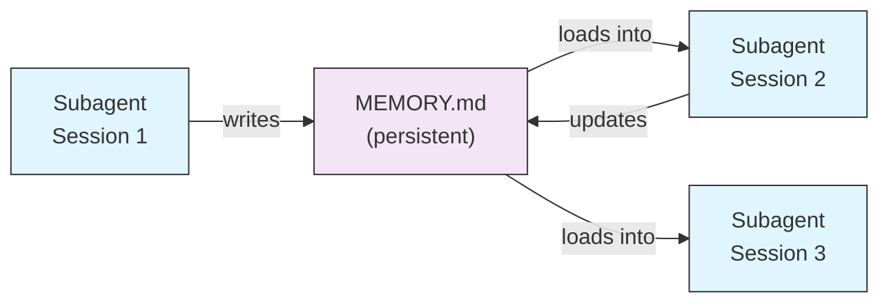
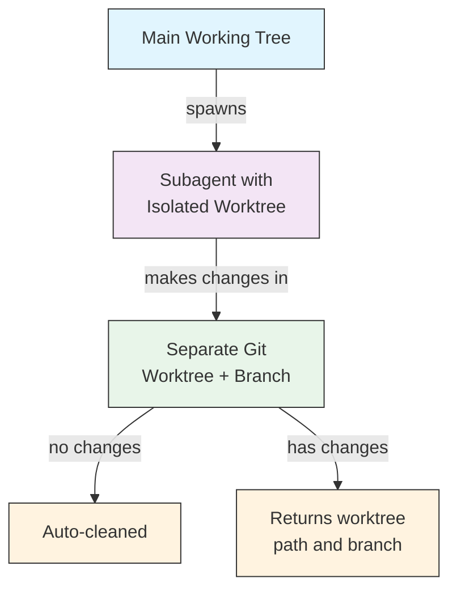
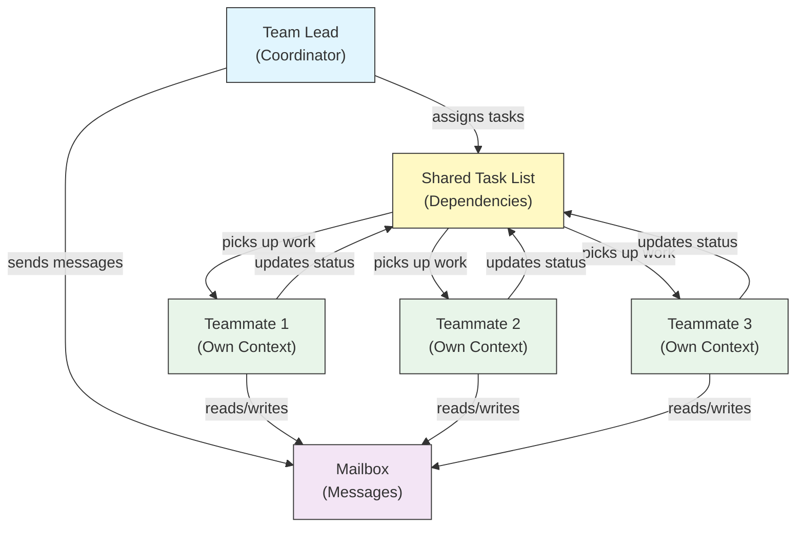
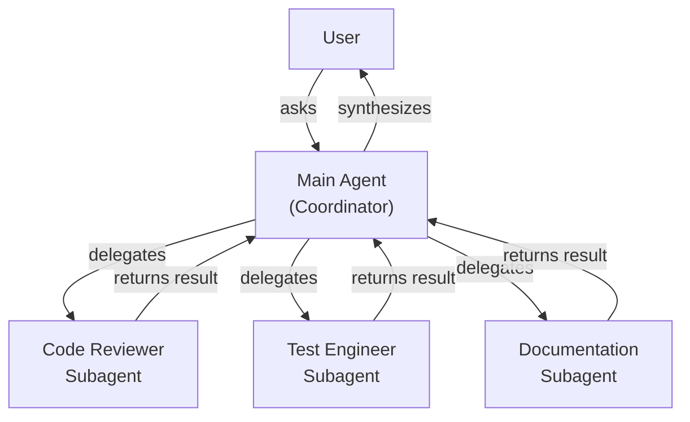
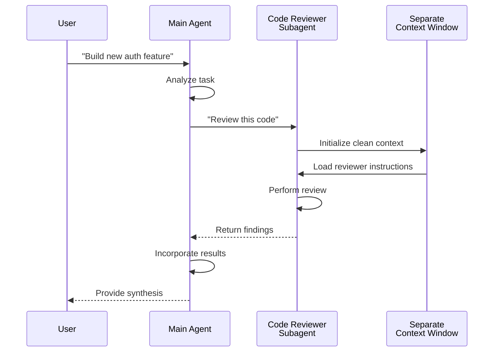
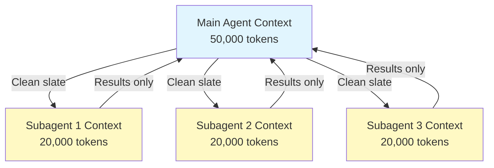
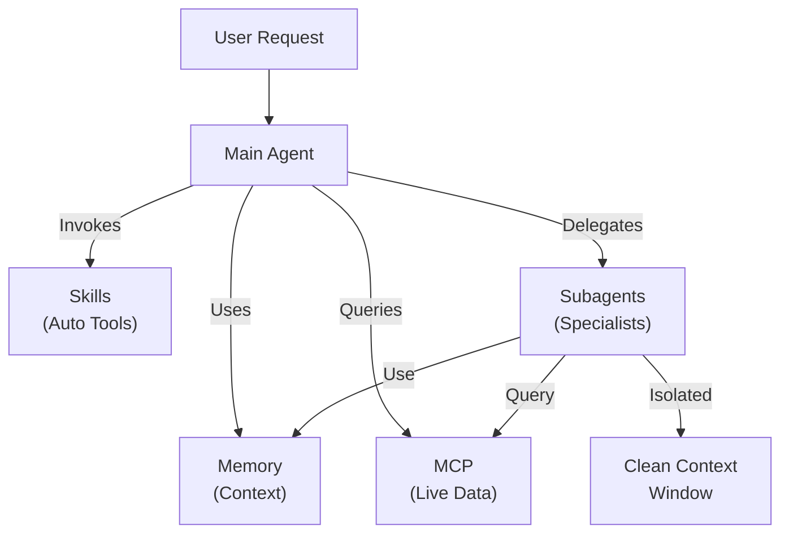

<picture>
  <source media="(prefers-color-scheme: dark)" srcset="../../resources/logos/claude-howto-logo-dark.svg">
  
</picture>

# Subagentها - راهنمای کامل مرجع

Subagentها دستیاران هوش مصنوعی تخصصی هستند که Claude Code می‌تواند وظایف را به آن‌ها تفویض کند. هر subagent هدف مشخصی دارد، از پنجره زمینه جداگانه‌ای نسبت به گفت‌وگوی اصلی استفاده می‌کند، و می‌تواند با ابزارهای مشخص و یک پرامپت سیستم سفارشی پیکربندی شود.

## فهرست مطالب

۱. [نمای کلی](#نمای-کلی)
۲. [مزایای کلیدی](#مزایای-کلیدی)
۳. [موقعیت فایل‌ها](#موقعیت-فایل‌ها)
۴. [پیکربندی](#پیکربندی)
۵. [Subagentهای داخلی](#subagentهای-داخلی)
۶. [مدیریت subagentها](#مدیریت-subagentها)
۷. [استفاده از subagentها](#استفاده-از-subagentها)
۸. [ایجنت‌های قابل‌ادامه](#ایجنتهای-قابلادامه)
۹. [زنجیره‌سازی subagentها](#زنجیرهسازی-subagentها)
۱۰. [حافظه پایدار برای subagentها](#حافظه-پایدار-برای-subagentها)
۱۱. [Subagentهای پس‌زمینه](#subagentهای-پسزمینه)
۱۲. [انزوای worktree](#انزوای-worktree)
۱۳. [Subagentهای forkشده](#subagentهای-forkشده)
۱۴. [محدودسازی subagentهای قابل‌تولید](#محدودسازی-subagentهای-قابلتولید)
۱۵. [فرمان CLI `claude agents`](#فرمان-cli-claude-agents)
۱۶. [تیم‌های ایجنت (آزمایشی)](#تیمهای-ایجنت-آزمایشی)
۱۷. [امنیت subagent پلاگین](#امنیت-subagent-پلاگین)
۱۸. [معماری](#معماری)
۱۹. [مدیریت زمینه](#مدیریت-زمینه)
۲۰. [چه‌زمان از subagentها استفاده کنیم](#چهزمان-از-subagentها-استفاده-کنیم)
۲۱. [بهترین شیوه‌ها](#بهترین-شیوهها)
۲۲. [subagentهای نمونه در این پوشه](#subagentهای-نمونه-در-این-پوشه)
۲۳. [دستورالعمل نصب](#دستورالعمل-نصب)
۲۴. [ساختار فایل](#ساختار-فایل)
۲۵. [مفاهیم مرتبط](#مفاهیم-مرتبط)
۲۶. [قابلیت مشاهده‌پذیری](#قابلیت-مشاهدهپذیری)
۲۷. [منابع تکمیلی](#منابع-تکمیلی)

---

## نمای کلی

Subagentها امکان اجرای تفویضی وظیفه را در Claude Code فراهم می‌کنند از طریق:

- ایجاد **دستیاران هوش مصنوعی منزوی** با پنجره‌های زمینه جداگانه
- ارائه **پرامپت‌های سیستم سفارشی** برای تخصص تخصصی
- اعمال **کنترل دسترسی ابزار** برای محدودسازی قابلیت‌ها
- جلوگیری از **آلودگی زمینه** ناشی از وظایف پیچیده
- امکان **اجرای موازی** وظایف تخصصی متعدد

هر subagent مستقل با صفحه تمیز کار می‌کند، فقط زمینه مشخص لازم برای وظیفه‌اش را دریافت می‌کند، سپس نتایج را به ایجنت اصلی بازمی‌گرداند برای ترکیب.

**شروع سریع**: از Claude بخواهید یک subagent برایتان بسازد («یک subagent بساز که امنیت را بازبینی کند»)، یا یک فایل `.claude/agents/<name>.md` مستقیماً اضافه کنید — به [مدیریت subagentها](#مدیریت-subagentها) در زیر مراجعه کنید.

> **توجه**: از v2.1.198، فرمان `/agents` دیگر جادوگر تعاملی ایجاد باز نمی‌کند. Subagentها را با درخواست از Claude یا ویرایش مستقیم فایل‌های `.claude/agents/` مدیریت کنید.

---

## مزایای کلیدی

| مزیت | شرح |
|---------|-------------|
| **حفظ زمینه** | در زمینه جداگانه کار می‌کند، از آلودگی گفت‌وگوی اصلی جلوگیری می‌کند |
| **تخصص تخصصی** | برای دامنه‌های مشخص بهینه‌شده با نرخ موفقیت بالاتر |
| **قابلیت استفاده مجدد** | در پروژه‌های مختلف استفاده و با تیم‌ها به اشتراک گذاشته می‌شود |
| **مجوزهای انعطاف‌پذیر** | سطوح دسترسی ابزار متفاوت برای انواع مختلف subagent |
| **مقیاس‌پذیری** | چندین ایجنت همزمان روی جنبه‌های مختلف کار می‌کنند |

---

## موقعیت فایل‌ها

فایل‌های subagent می‌توانند در چندین موقعیت با دامنه‌های متفاوت ذخیره شوند:

| اولویت | نوع | موقعیت | دامنه |
|----------|------|----------|-------|
| ۱ (بالاترین) | **مدیریت‌شده** | تنظیمات مدیریت‌شده | در سطح سازمان |
| ۲ | **تعریف‌شده با CLI** | از طریق پرچم `--agents` (JSON) | فقط نشست |
| ۳ | **Subagentهای پروژه** | `.claude/agents/` | پروژه فعلی |
| ۴ | **Subagentهای کاربر** | `~/.claude/agents/` | همه پروژه‌ها |
| ۵ (پایین‌ترین) | **ایجنت‌های پلاگین** | دایرکتوری `agents/` پلاگین | از طریق پلاگین‌ها |

وقتی نام‌های تکراری وجود داشته باشد، منابع با اولویت بالاتر تقدم دارند.

> **تقدم `.claude/` تودرتو (v2.1.178)**: وقتی نام یکسانی ایجنت در چندین دایرکتوری تودرتوی `.claude/agents/` تعریف شده باشد (مثلاً یک monorepo با پوشه‌های `.claude/` در سطح بسته)، تعریف **نزدیک‌ترین به دایرکتوری کاری فعلی شما برنده است**. همان قانون نزدیک‌ترین-برنده برای تعاریف workflow و output-style تودرتو نیز اعمال می‌شود.

---

## پیکربندی

### قالب فایل

Subagentها در YAML frontmatter به‌دنبال آن پرامپت سیستم در markdown تعریف می‌شوند:

```yaml
---
name: your-sub-agent-name
description: Description of when this subagent should be invoked
tools: tool1, tool2, tool3  # Optional - inherits all tools if omitted
disallowedTools: tool4  # Optional - explicitly disallowed tools
model: sonnet  # Optional - sonnet, opus, haiku, or inherit
permissionMode: default  # Optional - permission mode
maxTurns: 20  # Optional - limit agentic turns
skills: skill1, skill2  # Optional - skills to preload into context
mcpServers: server1  # Optional - MCP servers to make available
memory: user  # Optional - persistent memory scope (user, project, local)
background: false  # Optional - run as background task
effort: high  # Optional - reasoning effort (low, medium, high, xhigh, max)
isolation: worktree  # Optional - git worktree isolation
initialPrompt: "Start by analyzing the codebase"  # Optional - auto-submitted first turn
experimental:  # Optional - experimental settings block
  cacheTtl: "1h"  # Cache TTL for this subagent: "5m" or "1h" (v2.1.248+)
hooks:  # Optional - component-scoped hooks
  PreToolUse:
    - matcher: "Bash"
      hooks:
        - type: command
          command: "./scripts/security-check.sh"
---

Your subagent's system prompt goes here. This can be multiple paragraphs
and should clearly define the subagent's role, capabilities, and approach
to solving problems.
```

### فیلدهای پیکربندی

| فیلد | الزامی | شرح |
|-------|----------|-------------|
| `name` | Yes | شناسه یکتا (حروف کوچک و خط‌ممیز). جستجو نرمال‌سازی شده است (نام‌حساس و جداکننده‌نامحساس — در زیر ببینید)، اما نامی که حاوی `:` باشد از v2.1.218 **رد می‌شود**: `:` برای namespaceing پلاگین رزرو شده است |
| `description` | Yes | شرح زبان طبیعی هدف. شامل «use PROACTIVELY» برای تشویق فراخوانی خودکار |
| `tools` | No | فهرست جدا با کامای ابزارهای مشخص. برای ارث‌بری همه ابزارها حذف کنید. نحو `Agent(agent_name)` را برای محدودسازی subagentهای قابل‌تولید پشتیبانی می‌کند وقتی ایجنت به‌عنوان نخ اصلی با `claude --agent` اجرا می‌شود؛ داخل یک subagent فهرست نوع نادیده گرفته می‌شود. MCP: `mcp__<server>__*` یک سرور کامل را اعطا می‌کند (v2.1.299+: فقط آن نام سرور دقیق را تطبیق می‌دهد). |
| `disallowedTools` | No | فهرست جدا با کامای ابزارهایی که subagent نباید استفاده کند |
| `model` | No | مدل برای استفاده: `sonnet`، `opus`، `haiku`، شناسه کامل مدل، یا `inherit`. پیش‌فرض مدل subagent پیکربندی‌شده |
| `permissionMode` | No | `default` (حالت دستی؛ `manual` از v2.1.200 نام مستعار پذیرفته است)، `acceptEdits`، `dontAsk`، `bypassPermissions`، `plan`، `auto`. از v2.1.212، پارامتر فراخوانی `mode` ابزار Task منسوخ و نادیده گرفته شده است — subagentها به‌طور پیش‌فرض حالت مجوز نشست والد را به ارث می‌برند مگر اینکه اینجا override شود. وقتی والد در `bypassPermissions`، `acceptEdits` یا `auto` اجرا می‌شود، `permissionMode` subagent نادیده گرفته می‌شود |
| `maxTurns` | No | حداکثر تعداد نوبت‌های ایجنتی که subagent می‌تواند بگیرد |
| `skills` | No | فهرست جدا با کامای skillها برای پیش‌بارگذاری. محتوای کامل skill را در زمینه subagent هنگام راه‌اندازی تزریق می‌کند. **v2.1.133+:** subagentها همچنین skillهای پروژه، کاربر و پلاگین را از طریق ابزار Skill کشف می‌کنند — همان کاتالوگ نشست اصلی، دیگر محدود به مجموعه جاسازی‌شده خود نیست. نهایتاً ۳۲ skill پیش‌بارگذاری می‌شوند، هر کدام یک‌بار؛ یک subagent با ابزار Skill همچنان می‌تواند بقیه را فراخوانی کند (v2.1.295). |
| `mcpServers` | No | سرورهای MCP برای در دسترس قرار دادن به subagent |
| `hooks` | No | هوک‌هایی که فقط هنگام فعال بودن این subagent اجرا می‌شوند. همه رویدادهای هوک پشتیبانی می‌شوند؛ رایج‌ترین `PreToolUse`، `PostToolUse`، `Stop` هستند (به‌عنوان `SubagentStop` اجرا می‌شوند) |
| `memory` | No | دامنه دایرکتوری حافظه پایدار: `user`، `project`، یا `local` |
| `background` | No | Subagentها از قبل به‌طور پیش‌فرض در پس‌زمینه اجرا می‌شوند (v2.1.198). از v2.1.302 اپ دسکتاپ و VS Code نیز همیشه subagentهای گفت‌وگوی اصلی را در پس‌زمینه اجرا می‌کنند؛ فراخوانی‌های Agent خودِ subagent در `claude -p`، Agent SDK، اپ دسکتاپ و VS Code به‌طور پیش‌فرض در پیش‌زمینه اجرا می‌شوند. روی `true` تنظیم کنید تا همیشه پس‌زمینه را اجبار کنید و از اجرای درون‌خطی جلوگیری کنید |
| `effort` | No | سطح تلاش استدلال: `low`، `medium`، `high`، `xhigh`، یا `max`. سطح تلاش نشست را override می‌کند؛ سطوح موجود بسته به مدل متفاوت است. Claude همچنین می‌تواند هنگام فراخوانی ابزار Agent یک مقدار `effort` عبور دهد (v2.1.292). |
| `isolation` | No | روی `worktree` تنظیم کنید تا به subagent یک git worktree اختصاصی بدهید |
| `initialPrompt` | No | اولین نوبت خودکار ارسالی وقتی subagent به‌عنوان ایجنت اصلی اجرا می‌شود |
| `color` | No | رنگ نمایش برای subagent در فهرست وظایف و transcript. `red`، `blue`، `green`، `yellow`، `purple`، `orange`، `pink`، یا `cyan` را می‌پذیرد |
| `experimental` | No | بلوک تنظیمات آزمایشی (v2.1.248+). `experimental.cacheTtl` زمان‌سنجی cache را برای این subagent تنظیم می‌کند — `"5m"` یا `"1h"` |
| `omitClaudeMd` | No | روی `true` تنظیم کنید تا subagent بدون فایل‌های CLAUDE.md کاربر، پروژه و محلی راه‌اندازی شود (v2.1.271+). فایل‌های سیاست مدیریت‌شده همچنان بارگذاری می‌شوند، به‌جز برای subagentهای مدیریت‌شده. وقتی ایجنت به‌عنوان ایجنت نشست اصلی از طریق `--agent` یا تنظیم `agent` اجرا می‌شود نادیده گرفته می‌شود. همچنین در JSON `--agents` پذیرفته است |
| `autoCompactWindow` | No | زمینه subagent را زودتر از پنجره گفت‌وگوی اصلی auto-compact کنید (v2.1.296+؛ همچنین در JSON `--agents` پذیرفته است) |

#### متغیرهای محیطی مدل Subagent

دو متغیر محیطی روی مدلی که subagent روی آن اجرا می‌شود تأثیر دارند:

| متغیر | نسخه | شرح |
|----------|---------|-------------|
| `CLAUDE_CODE_SUBAGENT_MODEL` | — | مدلی که برای subagentها استفاده می‌شود را تنظیم می‌کند |
| `CLAUDE_CODE_SUBAGENT_MODEL_FORCE` | v2.1.257+ | روی `1` تنظیم کنید تا مدل subagent روی frontmatter `model:` subagent تحمیل شود |

> **تقدم در v2.1.251 تغییر کرد**: پیش از آن نسخه، `CLAUDE_CODE_SUBAGENT_MODEL` اول می‌آمد و frontmatter ایجنت را override می‌کرد — از جمله `model: inherit`. از v2.1.251 به بعد، frontmatter `model:` خودِ subagent برنده است. وقتی می‌خواهید متغیر محیطی دوباره frontmatter را override کند، `CLAUDE_CODE_SUBAGENT_MODEL_FORCE=1` (v2.1.257+) تنظیم کنید، مثلاً برای پین‌کردن یک اجرای ارزیابی کامل به یک مدل.

### تقدم Frontmatter ایجنت نخ اصلی (v2.1.117+/v2.1.119+)

وقتی یک ایجنت به‌عنوان ایجنت نخ اصلی فراخوانی می‌شود (از طریق `claude --agent <name>` یا حالت `--print`)، این فیلدهای frontmatter تقدم دارند:

| فیلد | نسخه | نکات |
|-------|---------|-------|
| `mcpServers` | v2.1.117+ | وقتی ایجنت به‌عنوان ایجنت نخ اصلی از طریق `claude --agent <name>` فراخوانی می‌شود بارگذاری می‌شود |
| `permissionMode` | v2.1.119+ | برای ایجنت‌های داخلی از طریق `--agent <name>` تقدم دارد |
| `tools` / `disallowedTools` | v2.1.119+ | در حالت `--print` تقدم دارد (استفاده اسکریپتی/غیرتعاملی) |

**نمونه — ایجنت با `mcpServers` و `permissionMode`:**

```yaml
---
name: secure-researcher
description: Research agent with scoped MCP access and restricted permissions
permissionMode: acceptEdits
mcpServers:
  notion:
    type: http
    url: https://mcp.notion.com/mcp
  github:
    type: http
    url: https://api.githubcopilot.com/mcp/
    headers:
      Authorization: "Bearer ${GITHUB_PERSONAL_ACCESS_TOKEN}"
tools: Read, Grep, Glob
---

You are a research agent. You may query Notion and GitHub through the
configured MCP servers, and read local files, but you cannot write or
execute commands outside of accepted edits.
```

اجرا با:

```bash
claude --agent secure-researcher
```

### گزینه‌های پیکربندی ابزار

**گزینه ۱: ارث‌بری همه ابزارها (حذف فیلد)**
```yaml
---
name: full-access-agent
description: Agent with all available tools
---
```

**گزینه ۲: مشخص کردن ابزارهای منفرد**
```yaml
---
name: limited-agent
description: Agent with specific tools only
tools: Read, Grep, Glob, Bash
---
```

> **نکته درباره Glob/Grep (v2.1.113+):** در buildهای بومی macOS/Linux، Glob و Grep به‌عنوان `bfs`/`ugrep` از طریق ابزار Bash ارائه می‌شوند نه به‌عنوان ابزارهای جداگانه. Buildهای ویندوز و npm-JS همچنان آن‌ها را به‌عنوان ابزارهای مستقل ارائه می‌دهند. مؤلفان همچنان می‌توانند به Glob/Grep در `allowedTools` ارجاع دهند؛ جایگزینی بک‌اند شفاف است.

**گزینه ۳: دسترسی ابزار مشروط**
```yaml
---
name: conditional-agent
description: Agent with filtered tool access
tools: Read, Bash(npm:*), Bash(test:*)
---
```

### پیکربندی مبتنی بر CLI

Subagentها را برای یک نشست واحد با پرچم `--agents` با قالب JSON تعریف کنید:

```bash
claude --agents '{
  "code-reviewer": {
    "description": "Expert code reviewer. Use proactively after code changes.",
    "prompt": "You are a senior code reviewer. Focus on code quality, security, and best practices.",
    "tools": ["Read", "Grep", "Glob", "Bash"],
    "model": "sonnet"
  }
}'
```

**قالب JSON برای پرچم `--agents`:**

```json
{
  "agent-name": {
    "description": "Required: when to invoke this agent",
    "prompt": "Required: system prompt for the agent",
    "tools": ["Optional", "array", "of", "tools"],
    "model": "optional: sonnet|opus|haiku"
  }
}
```

> **توجه**: از v2.1.243، `--agents` دیگر JSON نامعتبر یا تعاریف نامعتبر ایجنت را بی‌صدا نادیده نمی‌گیرد — Claude Code با یک خطای واضح خارج می‌شود، مطابق رفتار `--mcp-config`.

**تقدم تعاریف ایجنت:**

تعاریف ایجنت با این ترتیب تقدم بارگذاری می‌شوند (اولین تطبیق برنده است):
۱. **مدیریت‌شده** - تنظیمات مدیریت‌شده (در سطح سازمان)
۲. **تعریف‌شده با CLI** - پرچم `--agents` (فقط نشست، JSON)
۳. **سطح پروژه** - `.claude/agents/` (پروژه فعلی)
۴. **سطح کاربر** - `~/.claude/agents/` (همه پروژه‌ها)
۵. **سطح پلاگین** - دایرکتوری `agents/` پلاگین

این به تعاریف CLI اجازه می‌دهد برای یک نشست واحد تعاریف پروژه، کاربر و پلاگین را override کنند؛ تعاریف مدیریت‌شده همچنان تقدم دارند.

---

## Subagentهای داخلی

Claude Code شامل چندین subagent داخلی است که همیشه در دسترس هستند:

| ایجنت | مدل | هدف |
|-------|-------|---------|
| **general-purpose** | ارث‌بری | وظایف پیچیده چندمرحله‌ای |
| **Plan** | ارث‌بری | تحقیق برای حالت plan |
| **Explore** | ارث‌بری (Cap در Opus) | کاوش کدبیس فقط‌خواندنی (سریع/متوسط/بسیار کامل) |
| **claude** | ارث‌بری | همه‌کاره برای وظایفی که در ایجنت تخصصی‌تر جای نمی‌گیرند؛ همه ابزارهای موجود برای subagentها را دارد. همچنین ایجنت پیش‌فرض برای یک نشست پس‌زمینه ارسال‌شده |
| **statusline-setup** | Sonnet | وقتی `/statusline` را برای پیکربندی خط وضعیت استفاده می‌کنید اجرا می‌شود |
| **claude-code-guide** | Haiku | به پرسش‌ها درباره ویژگی‌های Claude Code پاسخ می‌دهد |

### Subagent general-purpose

| خصوصیت | مقدار |
|----------|-------|
| **مدل** | از والد ارث‌بری می‌کند |
| **ابزارها** | همه ابزارها |
| **هدف** | وظایف تحقیقی پیچیده، عملیات چندمرحله‌ای، تغییرات کد |

**چه‌زمان استفاده می‌شود**: وظایفی که هم کاوش و هم تغییر با استدلال پیچیده نیاز دارند.

### Subagent Plan

| خصوصیت | مقدار |
|----------|-------|
| **مدل** | از والد ارث‌بری می‌کند |
| **ابزارها** | Read، Glob، Grep، Bash |
| **هدف** | به‌طور خودکار در حالت plan برای تحقیق کدبیس استفاده می‌شود |

**چه‌زمان استفاده می‌شود**: وقتی Claude باید کدبیس را پیش از ارائه یک plan درک کند.

### Subagent Explore

| خصوصیت | مقدار |
|----------|-------|
| **مدل** | مدل نشست را ارث‌بری می‌کند، cap در Opus (v2.1.198). روی `model: haiku` تنظیم کنید تا سریع و ارزان بماند |
| **حالت** | کاملاً فقط‌خواندنی |
| **ابزارها** | Glob، Grep، Read، Bash (فقط فرمان‌های فقط‌خواندنی) |
| **هدف** | جستجو و تحلیل سریع کدبیس |

**چه‌زمان استفاده می‌شود**: هنگام جستجو/درک کد بدون تغییر.

**سطوح کامل‌بودن** - عمق کاوش را مشخص کنید:
- **"quick"** - جستجوهای سریع با حداقل کاوش، خوب برای یافتن الگوهای مشخص
- **"medium"** - کاوش متعادل، سرعت و کامل‌بودن توازن‌شده، رویکرد پیش‌فرض
- **"very thorough"** - تحلیل جامع در چندین موقعیت و قرارداد نام‌گذاری، ممکن است طولانی‌تر باشد

### Subagent Claude

| خصوصیت | مقدار |
|----------|-------|
| **مدل** | از والد ارث‌بری می‌کند |
| **ابزارها** | هر ابزاری که برای subagentها موجود است |
| **هدف** | ایجنت همه‌کاره برای وظایفی که در ایجنت داخلی تخصصی‌تر جای نمی‌گیرند |

**چه‌زمان استفاده می‌شود**: وقتی یک وظیفه با یک ایجنت داخلی تخصصی‌تر تطبیق نمی‌کند. همچنین ایجنت پیش‌فرض برای یک نشست پس‌زمینه ارسال‌شده است؛ اینکه در کدام حالت مجوز شروع می‌کند بستگی به نحوه راه‌اندازی آن نشست دارد.

### Subagent راه‌اندازی Statusline

| خصوصیت | مقدار |
|----------|-------|
| **مدل** | Sonnet |
| **ابزارها** | Read، Write، Bash |
| **هدف** | پیکربندی نمایش خط وضعیت Claude Code |

**چه‌زمان استفاده می‌شود**: هنگام راه‌اندازی یا سفارشی‌سازی خط وضعیت.

### Subagent راهنمای Claude Code (`claude-code-guide`)

| خصوصیت | مقدار |
|----------|-------|
| **مدل** | Haiku (سریع، کم‌تاخیری) |
| **ابزارها** | فقط‌خواندنی |
| **هدف** | پاسخ به پرسش‌ها درباره ویژگی‌ها و استفاده Claude Code |

**چه‌زمان استفاده می‌شود**: وقتی کاربران درباره نحوه کار Claude Code یا نحوه استفاده از ویژگی‌های مشخص سؤال می‌کنند.

---

## مدیریت subagentها

### از Claude بپرسید (توصیه‌شده)

ساده‌ترین راه برای ایجاد یا مدیریت یک subagent این است که مستقیماً از Claude بخواهید:

```text
Create a subagent that reviews code for security vulnerabilities.
```

Claude فایل `.claude/agents/<name>.md` را برایتان می‌نویسد، با انتخاب frontmatter معقول (ابزارها، مدل، شرح). سپس می‌توانید فایل را دستی پالایش کنید یا از Claude بخواهید آن را تنظیم کند.

> **توجه**: فرمان `/agents` دیگر جادوگر تعاملی ایجاد باز نمی‌کند (حذف در v2.1.198). اکنون شما را به درخواست از Claude یا ویرایش مستقیم فایل‌های `.claude/agents/` ارجاع می‌دهد.

### مدیریت مستقیم فایل

```bash
# Create a project subagent
mkdir -p .claude/agents
cat > .claude/agents/test-runner.md << 'EOF'
---
name: test-runner
description: Use proactively to run tests and fix failures
---

You are a test automation expert. When you see code changes, proactively
run the appropriate tests. If tests fail, analyze the failures and fix
them while preserving the original test intent.
EOF

# Create a user subagent (available in all projects)
mkdir -p ~/.claude/agents
```

---

## استفاده از subagentها

### تفویض خودکار

Claude به‌طور پرواکتیو وظایف را بر اساس:
- شرح وظیفه در درخواست شما
- فیلد `description` در پیکربندی‌های subagent
- زمینه فعلی و ابزارهای موجود

تفویض می‌کند.

برای تشویق استفاده پرواکتیو، شامل «use PROACTIVELY» یا «MUST BE USED» در فیلد `description` خود:

```yaml
---
name: code-reviewer
description: Expert code review specialist. Use PROACTIVELY after writing or modifying code.
---
```

### فراخوانی صریح

می‌توانید به‌طور صریح یک subagent مشخص درخواست کنید:

```
> Use the test-runner subagent to fix failing tests
> Have the code-reviewer subagent look at my recent changes
> Ask the debugger subagent to investigate this error
```

> **تطبیق `subagent_type` نام‌حساس و جداکننده‌نامحساس (v2.1.140)**: `subagent_type` (در فراخوانی‌های ابزار Agent یا پرچم‌های `--agent`) به‌طور نام‌حساس تطبیق داده می‌شود و سبک جداکننده را نادیده می‌گیرد — `code-reviewer`، `Code Reviewer`، و `code_reviewer` همگی به همان ایجنت resolve می‌شوند. این یک مشکل طولانی را برطرف می‌کند که در آن تفاوت‌های جزئی در بزرگ‌نویسی بی‌صدا به ایجنت پیش‌فرض برمی‌گشت.

### فراخوانی @-mention

از پیشوند `@` استفاده کنید تا تضمین کنید یک subagent مشخص فراخوانی می‌شود (از اکتشاف‌های تفویض خودکار عبور می‌کند):

```
> @"code-reviewer (agent)" review the auth module
```

### ایجنت در سطح نشست

یک نشست کامل را با یک ایجنت مشخص به‌عنوان ایجنت اصلی اجرا کنید:

```bash
# Via CLI flag
claude --agent code-reviewer

# Via settings.json
{
  "agent": "code-reviewer"
}
```

### فهرست‌کردن ایجنت‌های موجود

برای دیدن اینکه کدام subagentها پیکربندی شده‌اند، از Claude بپرسید یا `.claude/agents/` و `~/.claude/agents/` را مرور کنید. (`claude agents` نامرتبط است: نمای ایجنت را برای نشست‌های پس‌زمینه باز می‌کند — به [CLI](../10-cli/README.md#agent-view-claude-agents-v21139) مراجعه کنید).

---

## ایجنت‌های قابل‌ادامه

Subagentها می‌توانند گفت‌وگوهای قبلی را با حفظ کامل زمینه ادامه دهند:

```bash
# Initial invocation
> Use the code-analyzer agent to start reviewing the authentication module
# Returns agentId: "abc123"

# Resume the agent later
> Resume agent abc123 and now analyze the authorization logic as well
```

**موارد استفاده**:
- تحقیق طولانی‌مدت در چندین نشست
- پالایش تکراری بدون از دست دادن زمینه
- جریان‌های کاری چندمرحله‌ای که زمینه را حفظ می‌کنند

---

## زنجیره‌سازی subagentها

چندین subagent را به ترتیب اجرا کنید:

```bash
> First use the code-analyzer subagent to find performance issues,
  then use the optimizer subagent to fix them
```

این جریان‌های کاری پیچیده را ممکن می‌کند که در آن خروجی یک subagent به دیگری خوراک می‌شود.

---

## حافظه پایدار برای subagentها

فیلد `memory` به subagentها یک دایرکتوری پایدار می‌دهد که در طول گفت‌وگوها باقی می‌ماند. این به subagentها اجازه می‌دهد در طول زمان دانش انباشته کنند، و یادداشت‌ها، یافته‌ها و زمینه‌ای که بین نشست‌ها پایدار است ذخیره کنند.

### دامنه‌های حافظه

| دامنه | دایرکتوری | مورد استفاده |
|-------|-----------|----------|
| `user` | `~/.claude/agent-memory/<name>/` | یادداشت‌ها و ترجیحات شخصی در همه پروژه‌ها |
| `project` | `.claude/agent-memory/<name>/` | دانش مخصوص پروژه به اشتراک با تیم |
| `local` | `.claude/agent-memory-local/<name>/` | دانش پروژه محلی که به کنترل نسخه commit نمی‌شود |

### نحوه کار

- ۲۰۰ خط اول `MEMORY.md` در دایرکتوری حافظه به‌طور خودکار در پرامپت سیستم subagent بارگذاری می‌شود
- ابزارهای `Read`، `Write`، و `Edit` به‌طور خودکار برای subagent فعال می‌شوند تا فایل‌های حافظه‌اش را مدیریت کند
- Subagent می‌تواند فایل‌های اضافی در دایرکتوری حافظه‌اش در صورت نیاز ایجاد کند

### نمونه پیکربندی

```yaml
---
name: researcher
description: Research assistant that keeps findings in persistent memory across sessions
memory: user
---

You are a research assistant. Use your memory directory to store findings,
track progress across sessions, and build up knowledge over time.

Check your MEMORY.md file at the start of each session to recall previous context.
```



---

## Subagentهای پس‌زمینه

Subagentها به‌طور پیش‌فرض در پس‌زمینه اجرا می‌شوند (v2.1.198). از v2.1.302 اپ دسکتاپ و VS Code نیز همیشه subagentهای گفت‌وگوی اصلی را در پس‌زمینه اجرا می‌کنند؛ فراخوانی‌های Agent خودِ subagent در `claude -p`، Agent SDK، اپ دسکتاپ و VS Code به‌طور پیش‌فرض در پیش‌زمینه اجرا می‌شوند. Claude به کار روی گفت‌وگوی اصلی ادامه می‌دهد هنگام اجرای یک subagent و هنگام پایان آن مطلع می‌شود، بنابراین دیگر منتظر بازگشت یک subagent قبل از ادامه نمی‌مانید.

### پیکربندی

چون پس‌زمینه از قبل پیش‌فرض است، `background: true` در frontmatter subagent را به اجرای همیشه در پس‌زمینه اجبار می‌کند و از اجرای درون‌خطی آن جلوگیری می‌کند:

```yaml
---
name: long-runner
background: true
description: Performs long-running analysis tasks in the background
---
```

### میانبرهای صفحه‌کلید

| میانبر | اقدام |
|----------|--------|
| `Ctrl+B` | پس‌زمینه‌کردن یک وظیفه subagent در حال اجرا |
| `Ctrl+X` `Ctrl+K` | توقف همه subagentهای پس‌زمینه در حال اجرا (دو بار در ۳ ثانیه برای تأیید فشار دهید؛ این `Ctrl+F` را جایگزین کرد) |

### غیرفعال‌کردن وظایف پس‌زمینه

متغیر محیطی را تنظیم کنید تا پشتیبانی وظیفه پس‌زمینه را کاملاً غیرفعال کنید:

```bash
export CLAUDE_CODE_DISABLE_BACKGROUND_TASKS=1
```

---

## انزوای worktree

تنظیم `isolation: worktree` به یک subagent git worktree اختصاصی‌اش را می‌دهد، و به آن اجازه می‌دهد مستقل تغییر ایجاد کند بدون تأثیر بر درخت کاری اصلی.

### پیکربندی

```yaml
---
name: feature-builder
isolation: worktree
description: Implements features in an isolated git worktree
tools: Read, Write, Edit, Bash, Grep, Glob
---
```

### نحوه کار



- Subagent در git worktree خودش روی یک شاخه جداگانه کار می‌کند
- اگر subagent تغییری ایجاد نکند، worktree به‌طور خودکار پاکسازی می‌شود
- اگر تغییراتی وجود داشته باشد، مسیر worktree و نام شاخه به ایجنت اصلی بازگردانده می‌شود برای بازبینی یا merge

---

## Subagentهای forkشده

یک subagent forkشده کل گفت‌وگوی والد را در لحظه fork به ارث می‌برد — پرامپت سیستم، ابزارها، مدل، تاریخچه پیام و prompt cache — به‌جای شروع با صفحه تمیز. این برای کاوش مسیرهای جایگزین بدون از دست دادن کار انجام‌شده مفید است.

> **دسترس‌بودن**: GA در v2.1.117. **از v2.1.232، حالت fork به‌طور پیش‌فرض در نشست‌های تعاملی روشن است** — در هر build، first-party یا نه. از v2.1.302 همچنین به‌طور پیش‌فرض در حالت غیرتعاملی (`claude -p`)، Agent SDK، اپ دسکتاپ و VS Code روشن است؛ `claude mcp serve` هرگز subagent fork ارائه نمی‌دهد. در Claude Code قدیمی‌تر از v2.1.232، یا برای روشن‌کردن آن جایی که به‌طور پیش‌فرض خاموش است، `CLAUDE_CODE_FORK_SUBAGENT=1` تنظیم کنید.

> **Subagentهای حالت fork در پس‌زمینه اجرا می‌شوند.** جایی که حالت fork روشن است — همان‌طور که در یک نشست تعاملی پیش‌فرض است — Claude Code subagent را در پس‌زمینه اجرا می‌کند، forkشده و غیر-forkشده به‌یک‌سان.

### پیکربندی

شما یک fork را در یک فایل ایجنت تعریف نمی‌کنید. Claude یکی را از طریق ابزار Agent با `subagent_type: "fork"` آغاز می‌کند، یا شما خودتان با `/subtask <task>` (v2.1.212+) یکی را آغاز می‌کنید:

```text
/subtask Explore an alternative implementation path and report the trade-offs
```

یک fork نمی‌تواند forkهای بیشتری تولید کند. برای مسدود کردن forkها، قانون deny `Agent(fork)` را اضافه کنید:

```json
{
  "permissions": {
    "deny": ["Agent(fork)"]
  }
}
```

> **توجه**: `context: fork` یک فیلد frontmatter **skill** است (به [Skills](../03-skills/README.md) مراجعه کنید)، نه یک فیلد subagent. Claude Code فیلدهایی را که در یک تعریف ایجنت تشخیص نمی‌دهد بی‌صدا نادیده می‌گیرد.

### فعال‌کردن صریح حالت fork

`CLAUDE_CODE_FORK_SUBAGENT=0` را تنظیم کنید تا حالت fork همه‌جا خاموش شود. در نسخه‌های پیش از v2.1.302، روی `1` تنظیم کنید تا forkها در `claude -p` و Agent SDK روشن شوند.

```bash
export CLAUDE_CODE_FORK_SUBAGENT=0
claude
```

### چه‌زمان از fork در برابر زمینه تمیز استفاده کنیم

| سناریو | Fork (`subagent_type: "fork"`) | زمینه تمیز (پیش‌فرض) |
|----------|-----------------|-------------------------|
| کاوش پیاده‌سازی‌های جایگزین | Yes | No (زمینه را از دست می‌دهد) |
| تحقیق طولانی با زمینه موجود | Yes | No |
| وظیفه تخصصی مستقل | No | Yes |
| اجتناب از آلودگی زمینه | No | Yes |

---

## محدودسازی subagentهای قابل‌تولید

می‌توانید کنترل کنید کدام subagentها یک ایجنت که به‌عنوان نخ اصلی با `claude --agent` اجرا می‌شود مجاز است تولید کند، با استفاده از نحو `Agent(agent_type)` در فیلد `tools`. این راهی برای allowlist کردن subagentهای مشخص برای تفویض فراهم می‌کند. در یک تعریف subagent، هر فهرست نوع داخل پرانتزها نادیده گرفته می‌شود.

> **توجه**: در v2.1.63، ابزار `Task` به `Agent` تغییر نام داد. ارجاعات `Task(...)` موجود همچنان به‌عنوان نام مستعار کار می‌کنند.

### نمونه

```yaml
---
name: coordinator
description: Coordinates work between specialized agents
tools: Agent(worker, researcher), Read, Bash
---

You are a coordinator agent. You can delegate work to the "worker" and
"researcher" subagents only. Use Read and Bash for your own exploration.
```

در این نمونه، وقتی `claude --agent coordinator` را اجرا می‌کنید، نخ اصلی فقط می‌تواند subagentهای `worker` و `researcher` را تولید کند. نمی‌تواند هیچ subagent دیگری تولید کند، حتی اگر جای دیگر تعریف شده باشند. اگر `coordinator` به‌عنوان یک subagent اجرا شود، فهرست نوع نادیده گرفته می‌شود.

---

## فرمان CLI `claude agents`

`claude agents` **نمای ایجنت** (v2.1.139+) را باز می‌کند: یک فهرست تمام‌صفحه از نشست‌های پس‌زمینه شما گروه‌بندی‌شده بر اساس وضعیت. تعاریف subagent پیکربندی‌شده را فهرست نمی‌کند؛ از `claude agents --json` برای اسکریپت‌نویسی بر اساس وضعیت نشست استفاده کنید.

```bash
claude agents
claude agents --json
```

Subagentهای پیکربندی‌شده در `.claude/agents/` (پروژه) و `~/.claude/agents/` (کاربر) قرار دارند.

---

## تیم‌های ایجنت (آزمایشی)

تیم‌های ایجنت چندین نمونه Claude Code را هماهنگ می‌کنند که روی وظایف پیچیده با هم کار می‌کنند. برخلاف subagentها (که کارفرعی تفویض می‌شوند و نتایج بازمی‌گردند)، هم‌تیمی‌ها مستقل با پنجره‌های زمینه خود کار می‌کنند و می‌توانند مستقیماً از طریق یک سیستم صندوق‌پستی مشترک به یکدیگر پیام دهند.

> **مستندات رسمی**: [code.claude.com/docs/en/agent-teams](https://code.claude.com/docs/en/agent-teams)

> **توجه**: تیم‌های ایجنت آزمایشی و به‌طور پیش‌فرض غیرفعال هستند. نیاز به Claude Code v2.1.32+ دارد. پیش از استفاده فعالش کنید.

### Subagentها در برابر تیم‌های ایجنت

| جنبه | Subagentها | تیم‌های ایجنت |
|--------|-----------|-------------|
| **مدل تفویض** | والد کارفرعی را تفویض می‌کند، منتظر نتیجه می‌ماند | رهبر تیم کار را هماهنگ می‌کند، هم‌تیمی‌ها مستقل اجرا می‌کنند |
| **زمینه** | زمینه تازه برای هر کارفرعی، نتایج به والد distill می‌شود | هر هم‌تیمی پنجره زمینه پایدار خود را حفظ می‌کند |
| **هماهنگ‌سازی** | متوالی یا موازی، توسط والد مدیریت می‌شود | فهرست وظایف مشترک با مدیریت خودکار وابستگی |
| **ارتباط** | نتایج فقط به والد بازمی‌گردند (بدون پیام‌رسانی بین‌ایجنتی) | هم‌تیمی‌ها می‌توانند مستقیماً از طریق صندوق‌پستی به یکدیگر پیام دهند |
| **ادامه نشست** | پشتیبانی می‌شود | با هم‌تیمی‌های in-process پشتیبانی نمی‌شود |
| **بهترین برای** | کارفرعی‌های متمرکز و خوش‌تعریف | کار پیچیده نیاز به ارتباط بین‌ایجنتی و اجرای موازی |

### فعال‌کردن تیم‌های ایجنت

متغیر محیطی را تنظیم کنید یا به `settings.json` خود اضافه‌اش کنید:

```bash
export CLAUDE_CODE_EXPERIMENTAL_AGENT_TEAMS=1
```

یا در `settings.json`:

```json
{
  "env": {
    "CLAUDE_CODE_EXPERIMENTAL_AGENT_TEAMS": "1"
  }
}
```

### آغاز یک تیم

وقتی فعال شد، از Claude بخواهید با هم‌تیمی‌ها در پرامپت خود کار کند:

```
User: Build the authentication module. Use a team — one teammate for the API endpoints,
      one for the database schema, and one for the test suite.
```

Claude تیم را ایجاد می‌کند، وظایف را تخصیص می‌دهد، و کار را به‌طور خودکار هماهنگ می‌کند.

### حالت‌های نمایش

کنترل کنید فعالیت هم‌تیمی چگونه نمایش داده می‌شود:

| حالت | پرچم | شرح |
|------|------|-------------|
| **خودکار** | `--teammate-mode auto` | به‌طور خودکار بهترین حالت نمایش را برای ترمینال شما انتخاب می‌کند |
| **In-process** (پیش‌فرض) | `--teammate-mode in-process` | خروجی هم‌تیمی را درون‌خطی در ترمینال فعلی نشان می‌دهد |
| **Split-panes** | `--teammate-mode tmux` | هر هم‌تیمی را در یک pane جداگانه tmux یا iTerm2 باز می‌کند |
| **iTerm2** | `--teammate-mode iterm2` | (v2.1.186+) هم‌تیمی‌ها را در pane‌های اختصاصی iTerm2 تولید می‌کند. نیاز به CLI `it2` دارد؛ حالت auto هنگامی که یافت نمی‌شود هشدار می‌دهد |

```bash
claude --teammate-mode tmux
```

می‌توانید حالت نمایش را در `settings.json` نیز تنظیم کنید:

```json
{
  "teammateMode": "tmux"
}
```

> **توجه**: حالت split-pane نیاز به tmux یا iTerm2 دارد. در ترمینال VS Code، Windows Terminal یا Ghostty در دسترس نیست.

### ناوبری

برای جابه‌جایی بین هم‌تیمی‌ها، از کلیدهای بالا و پایین در پنل ایجنت استفاده کنید و Enter را فشار دهید (در حالت in-process)، یا در pane یک هم‌تیمی کلیک کنید (در حالت split-pane).

### پیکربندی تیم

پیکربندی‌های تیم در `~/.claude/teams/{team-name}/config.json` ذخیره می‌شوند.

### انتخاب مدل هم‌تیمی

از v2.1.234، تنظیم `/config` «Default teammate model» حذف شد. هم‌تیمی‌ها اکنون به‌طور پیش‌فرض مدل رهبر تیم را ارث‌بری می‌کنند، مگر اینکه فراخوانی spawn یک مدل متفاوت را صریحاً مشخص کند.

### معماری



**مؤلفه‌های کلیدی**:

- **رهبر تیم**: نشست اصلی Claude Code که تیم را ایجاد می‌کند، وظایف را تخصیص می‌دهد، و هماهنگ می‌کند
- **فهرست وظایف مشترک**: یک فهرست هماهنگ‌شده از وظایف با ردیابی خودکار وابستگی
- **صندوق‌پستی**: یک سیستم پیام‌رسانی بین‌ایجنتی برای هم‌تیمی‌ها جهت ارتباط وضعیت و هماهنگ‌سازی
- **هم‌تیمی‌ها**: نمونه‌های مستقل Claude Code، هر کدام با پنجره زمینه خود

### تخصیص وظیفه و پیام‌رسانی

رهبر تیم کار را به وظایف تقسیم می‌کند و آن‌ها را به هم‌تیمی‌ها تخصیص می‌دهد. فهرست وظایف مشترک مدیریت می‌کند:

- **مدیریت خودکار وابستگی** — وظایف منتظر تکمیل وابستگی‌های خود می‌مانند
- **ردیابی وضعیت** — هم‌تیمی‌ها وضعیت وظیفه را به‌محض کار به‌روزرسانی می‌کنند
- **پیام‌رسانی بین‌ایجنتی** — هم‌تیمی‌ها برای هماهنگ‌سازی از طریق صندوق‌پستی پیام می‌فرستند (مثلاً «شمای پایگاه داده آماده است، می‌توانید نوشتن پرس‌وجوها را آغاز کنید»)

### جریان تأیید plan

برای وظایف پیچیده، رهبر تیم پیش از آغاز کار هم‌تیمی‌ها یک plan اجرا ایجاد می‌کند. کاربر plan را بازبینی و تأیید می‌کند، و تضمین می‌کند که رویکرد تیم با انتظارات قبل از هر تغییر کدی هم‌راستا باشد.

### رویدادهای هوک برای تیم‌ها

تیم‌های ایجنت دو [رویداد هوک](../06-hooks/) اضافی معرفی می‌کنند:

| رویداد | چه‌زمان اجرا می‌شود | مورد استفاده |
|-------|-----------|----------|
| `TeammateIdle` | یک هم‌تیمی وظیفه فعلی‌اش را تمام می‌کند و کار در انتظار ندارد | راه‌اندازی اعلان‌ها، تخصیص وظایف پیگیری |
| `TaskCompleted` | یک وظیفه در فهرست وظایف مشترک کامل علامت‌خورده | اجرای اعتبارسنجی، به‌روزرسانی داشبوردها، زنجیره‌کردن کار وابسته |

### بهترین شیوه‌ها

- **اندازه تیم**: تیم‌ها را در ۳-۵ هم‌تیمی برای هماهنگ‌سازی بهینه نگه دارید
- **اندازه وظیفه**: کار را به وظایفی بشکنید که هر کدام ۵-۱۵ دقیقه طول بکشد — به اندازه کافی کوچک برای موازی‌سازی، به اندازه کافی بزرگ برای معنادار بودن
- **اجتناب از تعارض فایل**: فایل‌ها یا دایرکتوری‌های متفاوت به هم‌تیمی‌های متفاوت تخصیص دهید تا از تعارض merge جلوگیری شود
- **ساده شروع کنید**: برای اولین تیم خود از حالت in-process استفاده کنید؛ وقتی راحت شد به split-panes سوییچ کنید
- **شرح‌های واضح وظیفه**: شرح‌های وظیفه مشخص و actionable ارائه دهید تا هم‌تیمی‌ها بتوانند مستقل کار کنند

### محدودیت‌ها

- **آزمایشی**: رفتار ویژگی ممکن است در نسخه‌های آینده تغییر کند
- **بدون ادامه نشست**: هم‌تیمی‌های in-process پس از پایان یک نشست قابل ادامه نیستند
- **یک تیم در هر نشست**: نمی‌توان تیم‌های تودرتوی یا چندین تیم در یک نشست ایجاد کرد
- **رهبری ثابت**: نقش رهبر تیم نمی‌تواند به یک هم‌تیمی منتقل شود
- **محدودیت‌های split-pane**: نیاز به tmux/iTerm2؛ در ترمینال VS Code، Windows Terminal یا Ghostty در دسترس نیست
- **بدون تیم‌های بین‌نشستی**: هم‌تیمی‌ها فقط در نشست فعلی وجود دارند

> **هشدار**: تیم‌های ایجنت آزمایشی است. ابتدا با کار غیربحرانی آزمایش کنید و هماهنگ‌سازی هم‌تیمی را برای رفتار غیرمنتظره پایش کنید.

---

## امنیت subagent پلاگین

Subagentهای ارائه‌شده توسط پلاگین برای امنیت قابلیت‌های frontmatter محدودی دارند. فیلدهای زیر در تعاریف subagent پلاگین **مجاز نیستند**:

- `hooks` - نمی‌تواند هوک‌های چرخه‌حیات تعریف کند
- `mcpServers` - نمی‌تواند سرورهای MCP پیکربندی کند
- `permissionMode` - نمی‌تواند تنظیمات مجوز را override کند

این از پلاگین‌ها جلوگیری می‌کند تا از طریق هوک‌های subagent امتیاز بالا ببرند یا فرمان‌های دلخواه اجرا کنند.

### اسکن خروجی Subagent (v2.1.210+)

از v2.1.210، Claude Code گزارش نهایی هر subagent را برای متنی که قالب خروجی خود harness را تقلید می‌کند اسکن می‌کند — تگ‌های جعلی به سبک `<system-reminder>`، نوبت‌های جعلی `Human:`/`Assistant:`، یا ذکر پرچم‌های دورزدن مجوز و مسیرهای فایل تنظیمات. این در برابر prompt injection که در خروجی subagent حمل می‌شود دفاع می‌کند، مثلاً یک subagent که یک صفحه وب مخرب fetch کرده که حاوی توکن‌های کنترلی جعلی طراحی‌شده برای دستکاری نشست والد است.

وقتی اسکن چیزی را علامت‌گذاری می‌کند، Claude Code آن را خنثی می‌کند — یک backslash یا نشانگر درون‌خطی مانند `[harness: subagent output matched instruction-shaped pattern(s): ...]` که نام می‌برد چه چیزی اسکن را راه‌اندازی کرده — درج می‌کند، و انتظار می‌رود نشست والد متن علامت‌گذاری‌شده را به‌عنوان یک یافته برای انتقال behandelt کند، نه یک دستور برای پیگیری. اسکن به‌طور پیش‌فرض روشن است بدون opt-out مستند. به علامت‌گذاری گرایش دارد: یک گزارش subagent مشروع که نام یک پرچم واقعی (مثلاً `--dangerously-skip-permissions`) را verbatim نقل می‌کند می‌تواند یک نشانگر را راه‌اندازی کند حتی اگر هیچ چیز مخربی رخ نداده باشد — یک false positive بر یک تزریق از دست رفته ارجح است.

### محدودیت‌های هم‌زمانی و عمق Subagent

> **سقف تولید در هر نشست رفع شد.** Claude Code تولید subagent را در ۲۰۰ در هر نشست از v2.1.218 cap می‌کرد، اما **v2.1.224 این cap را حذف کرد** — نشست‌های طولانی‌مدت دیگر ایجنت‌های جدید را رد نمی‌کنند، و مرجع رسمی subagentها اکنون صراحتاً بیان می‌کند که هیچ محدودیتی روی تعداد کل subagentهایی که Claude می‌تواند در طول یک نشست تولید کند وجود ندارد. متغیر `CLAUDE_CODE_MAX_SUBAGENTS_PER_SESSION` که آن را override می‌کرد با آن از بین رفت.

دو محدودیت روی fan-out subagent همچنان اعمال می‌شود، هر دو با متغیر محیطی تنظیم‌شده:

- `CLAUDE_CODE_MAX_CONCURRENT_SUBAGENTS` (v2.1.217) - حداکثر تعداد subagentهای **به‌طور هم‌زمان** در حال اجرا. پیش‌فرض: ۲۰.
- `CLAUDE_CODE_MAX_SUBAGENT_SPAWN_DEPTH` (v2.1.217) - حداکثر **عمق تودرتویی** برای subagentهایی که subagentهای خودشان را تولید می‌کنند. **پیش‌فرض: ۳ از v2.1.219** (در v2.1.217–v2.1.218 معادل ۱ بود). روی `1` تنظیم کنید تا تودرتویی غیرفعال شود (به [رفتارهای کلیدی](#key-behaviors) مراجعه کنید).

```bash
export CLAUDE_CODE_MAX_CONCURRENT_SUBAGENTS=20
export CLAUDE_CODE_MAX_SUBAGENT_SPAWN_DEPTH=5
```

---

## معماری

### معماری سطح‌بالا



### چرخه‌حیات Subagent



---

## مدیریت زمینه



### نکات کلیدی

- هر subagent یک **پنجره زمینه تازه** بدون تاریخچه گفت‌وگوی اصلی دریافت می‌کند
- فقط **زمینه مرتبط** به subagent برای وظیفه مشخصش پاس داده می‌شود
- نتایج به ایجنت اصلی **distill** بازمی‌گردند
- این از **اگزوزشن توکن زمینه** در پروژه‌های طولانی جلوگیری می‌کند

### ملاحظات کارایی

- **کارایی زمینه** - ایجنت‌ها زمینه اصلی را حفظ می‌کنند، نشست‌های طولانی‌تر را ممکن می‌کنند
- **تاخیری** - Subagentها با صفحه تمیز شروع می‌شوند و ممکن است در جمع‌آوری زمینه اولیه تاخیری اضافه کنند

### رفتارهای کلیدی

- **تولید تودرتوی روشن به‌طور پیش‌فرض، عمق ۳ (v2.1.219)** - Subagentها می‌توانند subagentهای خودشان را تا سه لایه زیر گفت‌وگوی اصلی تولید کنند. `CLAUDE_CODE_MAX_SUBAGENT_SPAWN_DEPTH` را برای تغییر محدودیت تنظیم کنید، یا `1` برای خاموش‌کردن تودرتویی. در محدودیت عمق، Claude Code ابزار `Agent` را از هر subagent جز fork کسر می‌کند. (تاریخچه: v2.1.172–v2.1.216 به‌طور پیش‌فرض تا ۵ لایه تودرتوی می‌دادند بدون راهی برای تغییر آن؛ v2.1.217 تودرتویی را opt-in در عمق ۱ کرد؛ v2.1.219 پیش‌فرض را روی ۳ تنظیم کرد.) از نحو محدودسازی `Agent(agent_type)` (به [محدودسازی subagentهای قابل‌تولید](#restrict-spawnable-subagents) مراجعه کنید) برای کنترل اینکه کدام subagentها یک ایجنت نخ اصلی (`claude --agent`) ممکن است تولید کند استفاده کنید؛ داخل یک subagent فهرست نوع نادیده گرفته می‌شود
- **مجوزهای پس‌زمینه** - وقتی یک subagent پس‌زمینه به مجوزی نیاز دارد که از قبل تأیید نشده، پرامپت در نشست اصلی شما ظاهر می‌شود و نام subagentی که می‌پرسد را نام می‌برد
- **پس‌زمینه‌کردن** - `Ctrl+B` را فشار دهید تا یک وظیفه در حال اجرا را پس‌زمینه کنید
- **Transcriptها** - Transcriptهای subagent در `~/.claude/projects/{project}/{sessionId}/subagents/agent-{agentId}.jsonl` ذخیره می‌شوند
- **Auto-compact** - زمینه subagent در ~۹۵٪ ظرفیت auto-compact می‌شود (با متغیر محیطی `CLAUDE_AUTOCOMPACT_PCT_OVERRIDE` override کنید)
- **تفکر گسترش‌یافته به ارث برده (v2.1.198)** - Subagentها و فشرده‌سازی زمینه اکنون پیکربندی تفکر گسترش‌یافته نشست را ارث‌بری می‌کنند (پیش‌تر همیشه غیرفعال بود). فیلد تفکر برای هر subagent وجود ندارد

### کنترل‌های اضافی

- **غیرفعال‌کردن ایجنت‌های داخلی Explore/Plan** - `CLAUDE_CODE_DISABLE_EXPLORE_PLAN_AGENTS=1` را تنظیم کنید تا ایجنت‌های داخلی Explore و Plan حذف شوند (v2.1.198)
- **اضافه به هر پرامپت subagent** - در حالت غیرتعاملی / `--print`، `--append-subagent-system-prompt "<text>"` متن را به پرامپت سیستم هر subagent اضافه می‌کند (v2.1.205)
- **اضافه از یک فایل** - `--append-subagent-system-prompt-file ./subagent-rules.txt` همان متن اضافه‌شده را از یک فایل می‌خواند، برای پرامپت‌هایی که برای عبور در خط فرمان بیش از حد طولانی هستند. همچنین فقط `-p`، و نمی‌تواند با `--append-subagent-system-prompt` ترکیب شود (v2.1.261)

---

## چه‌زمان از subagentها استفاده کنیم

| سناریو | استفاده از Subagent | چرا |
|----------|--------------|-----|
| ویژگی پیچیده با مراحل زیاد | Yes | دغدغه‌ها را جدا کنید، از آلودگی زمینه جلوگیری کنید |
| بازبینی سریع کد | No | سربار غیرضروری |
| اجرای موازی وظیفه | Yes | هر subagent زمینه خود را دارد |
| نیاز به تخصص تخصصی | Yes | پرامپت‌های سیستم سفارشی |
| تحلیل طولانی‌مدت | Yes | از اگزوزشن زمینه اصلی جلوگیری می‌کند |
| وظیفه منفرد | No | به‌طور غیرضروری تاخیری اضافه می‌کند |

---

## بهترین شیوه‌ها

### اصول طراحی

**انجام دهید:**
- با ایجنت‌های تولیدشده با Claude شروع کنید - subagent اولیه را با Claude تولید کنید، سپس برای سفارشی‌سازی تکرار کنید
- subagentهای متمرکز طراحی کنید - مسئولیت‌های منفرد و واضح به‌جای یکی که همه‌کار می‌کند
- پرامپت‌های دقیق بنویسید - دستورالعمل‌های مشخص، نمونه‌ها و محدودیت‌ها بگنجانید
- دسترسی ابزار را محدود کنید - فقط ابزارهای لازم برای هدف subagent اعطا کنید
- کنترل نسخه - subagentهای پروژه را در کنترل نسخه برای همکاری تیمی check کنید

**انجام ندهید:**
- subagentهای همپوشان با نقش‌های یکسان ایجاد کنید
- دسترسی ابزار غیرضروری به subagentها بدهید
- از subagentها برای وظایف ساده تک‌مرحله‌ای استفاده کنید
- دغدغه‌ها را در پرامپت یک subagent مخلوط کنید
- فراموش کنید زمینه لازم را عبور دهید

### بهترین شیوه‌های پرامپت سیستم

۱. **درباره نقش مشخص باشید**
   ```
   You are an expert code reviewer specializing in [specific areas]
   ```

۲. **اولویت‌ها را واضح تعریف کنید**
   ```
   Review priorities (in order):
   1. Security Issues
   2. Performance Problems
   3. Code Quality
   ```

۳. **قالب خروجی را مشخص کنید**
   ```
   For each issue provide: Severity, Category, Location, Description, Fix, Impact
   ```

۴. **گام‌های اقدام بگنجانید**
   ```
   When invoked:
   1. Run git diff to see recent changes
   2. Focus on modified files
   3. Begin review immediately
   ```

### راهبرد دسترسی ابزار

۱. **محدودکننده شروع کنید**: فقط با ابزارهای ضروری شروع کنید
۲. **فقط هنگام نیاز گسترش دهید**: ابزارها را هنگامی که نیازمندی‌ها اقتضا می‌کنند اضافه کنید
۳. **هنگام ممکن فقط‌خواندنی**: برای ایجنت‌های تحلیلی از Read/Grep استفاده کنید
۴. **اجرای sandboxشده**: فرمان‌های Bash را به الگوهای مشخص محدود کنید

---

## subagentهای نمونه در این پوشه

این پوشه شامل subagentهای نمونه آماده‌استفاده است:

### ۱. بازبین کد (`code-reviewer.md`)

**هدف**: تحلیل جامع کیفیت و قابلیت نگهداری کد

**ابزارها**: Read, Grep, Glob, Bash

**تخصص**:
- تشخیص آسیب‌پذیری امنیتی
- شناسایی بهینه‌سازی کارایی
- ارزیابی قابلیت نگهداری کد
- تحلیل پوشش آزمون

**چه‌زمان استفاده می‌شود**: وقتی بازبینی خودکار کد با تمرکز بر کیفیت و امنیت نیاز دارید

---

### ۲. مهندس آزمون (`test-engineer.md`)

**هدف**: راهبرد آزمون، تحلیل پوشش و آزمون خودکار

**ابزارها**: Read, Write, Bash, Grep

**تخصص**:
- ایجاد آزمون واحد
- طراحی آزمون یکپارچه
- شناسایی موارد لبه‌ای
- تحلیل پوشش (هدف >۸۰٪)

**چه‌زمان استفاده می‌شود**: وقتی نیاز به ایجاد جامع مجموعه آزمون یا تحلیل پوشش دارید

---

### ۳. نویسنده مستندات (`documentation-writer.md`)

**هدف**: مستندات فنی، مستندات API و راهنمای کاربر

**ابزارها**: Read, Write, Grep

**تخصص**:
- مستندسازی endpointهای API
- ایجاد راهنمای کاربر
- مستندات معماری
- بهبود نظرات کد

**چه‌زمان استفاده می‌شود**: وقتی نیاز به ایجاد یا به‌روزرسانی مستندات پروژه دارید

---

### ۴. بازبین امن (`secure-reviewer.md`)

**هدف**: بازبینی کد متمرکز بر امنیت با حداقل مجوزها

**ابزارها**: Read, Grep

**تخصص**:
- تشخیص آسیب‌پذیری امنیتی
- مسائل احراز هویت/مجوزدهی
- ریسک‌های افشای داده
- شناسایی حمله تزریق

**چه‌زمان استفاده می‌شود**: وقتی ممیزی‌های امنیتی بدون قابلیت تغییر نیاز دارید

---

### ۵. ایجنت پیاده‌سازی (`implementation-agent.md`)

**هدف**: قابلیت‌های پیاده‌سازی کامل برای توسعه ویژگی

**ابزارها**: Read, Write, Edit, Bash, Grep, Glob

**تخصص**:
- پیاده‌سازی ویژگی
- تولید کد
- اجرای build و آزمون
- تغییر کدبیس

**چه‌زمان استفاده می‌شود**: وقتی یک subagent نیاز دارید تا ویژگی‌ها را end-to-end پیاده‌سازی کند

---

### ۶. دیباگر (`debugger.md`)

**هدف**: متخصص دیباگ برای خطاها، شکست آزمون‌ها و رفتار غیرمنتظره

**ابزارها**: Read, Edit, Bash, Grep, Glob

**تخصص**:
- تحلیل علت ریشه‌ای
- تحقیق خطا
- رفع شکست آزمون
- پیاده‌سازی راه‌حل حداقلی

**چه‌زمان استفاده می‌شود**: وقتی با باگ، خطا یا رفتار غیرمنتظره مواجه می‌شوید

---

### ۷. دانشمند داده (`data-scientist.md`)

**هدف**: متخصص تحلیل داده برای پرس‌وجوی SQL و بینش‌های داده

**ابزارها**: Bash, Read, Write

**تخصص**:
- بهینه‌سازی پرس‌وجوی SQL
- عملیات BigQuery
- تحلیل و مصورسازی داده
- بینش‌های آماری

**چه‌زمان استفاده می‌شود**: وقتی تحلیل داده، پرس‌وجوی SQL یا عملیات BigQuery نیاز دارید

---

### ۸. بازبین Clean Code (`clean-code-reviewer.md`)

**هدف**: بازبینی خوانایی و قابلیت نگهداری در برابر اصول clean-code

**ابزارها**: Read, Grep, Glob, Bash

**تخصص**:
- نام‌گذاری، طول تابع و تعداد آرگومان
- تکرار و کد مرده
- کیفیت و قصد نظرات
- وضوح ساختاری بر هوشمندی

**چه‌زمان استفاده می‌شود**: وقتی یک گذر سبک و قابلیت نگهداری متمایز از بازبینی درستی می‌خواهید

---

### ۹. بهینه‌ساز کارایی (`performance-optimizer.md`)

**هدف**: شناسایی و ترمیم گلوگاه‌های کارایی

**ابزارها**: Read, Edit, Bash, Grep, Glob

**تخصص**:
- پیچیدگی الگوریتمی و مسیرهای داغ
- تخصیص حافظه و نشت‌ها
- بهینه‌سازی cache و پرس‌وجو
- گلوگاه‌های هم‌زمانی و I/O

**چه‌زمان استفاده می‌شود**: وقتی کد به‌طور قابل‌سنجشی کند است و بهینه‌سازی هدفمند نیاز دارید

---

## دستورالعمل نصب

### روش ۱: از Claude بپرسید (توصیه‌شده)

subagent مورد نظر را شرح دهید و بگذارید Claude فایل را ایجاد کند:

```text
Create a project-level subagent that runs tests and fixes failures.
Give it access to Bash, Read, Edit, and Grep.
```

Claude `.claude/agents/<name>.md` را با frontmatter مناسب می‌نویسد. فایل تولیدشده را بازبینی کنید، سپس استفاده‌اش کنید. (جادوگر تعاملی ایجاد `/agents` در v2.1.198 حذف شد — به‌جای آن از Claude بپرسید یا فایل را مستقیماً ویرایش کنید.)

### روش ۲: کپی به پروژه

فایل‌های ایجنت را به دایرکتوری `.claude/agents/` پروژه خود کپی کنید:

```bash
# Navigate to your project
cd /path/to/your/project

# Create agents directory if it doesn't exist
mkdir -p .claude/agents

# Copy all agent files from this folder
cp /path/to/04-subagents/*.md .claude/agents/

# Remove the README (not needed in .claude/agents)
rm .claude/agents/README.md
```

### روش ۳: کپی به دایرکتوری کاربر

برای ایجنت‌های موجود در همه پروژه‌های شما:

```bash
# Create user agents directory
mkdir -p ~/.claude/agents

# Copy agents
cp /path/to/04-subagents/code-reviewer.md ~/.claude/agents/
cp /path/to/04-subagents/debugger.md ~/.claude/agents/
# ... copy others as needed
```

### تأیید

پس از نصب، با فهرست‌کردن دایرکتوری تأیید کنید ایجنت‌ها شناخته شده‌اند:

```bash
ls .claude/agents/
```

همچنین می‌توانید از Claude بپرسید کدام subagentها در نشست فعلی موجود هستند، و او ایجنت‌های داخلی و سفارشی که می‌تواند به آن‌ها تفویض کند را گزارش می‌دهد.

---

## ساختار فایل

```
project/
├── .claude/
│   └── agents/
│       ├── code-reviewer.md
│       ├── test-engineer.md
│       ├── documentation-writer.md
│       ├── secure-reviewer.md
│       ├── implementation-agent.md
│       ├── debugger.md
│       ├── data-scientist.md
│       ├── clean-code-reviewer.md
│       └── performance-optimizer.md
└── ...
```

---

## مفاهیم مرتبط

### ویژگی‌های مرتبط

- **[Slash Commands](../01-slash-commands/)** - میانبرهای سریع کاربر-فراخوانی
- **[Memory](../02-memory/)** - زمینه پایدار بین‌نشستی
- **[Skills](../03-skills/)** - قابلیت‌های خودکار قابل‌استفاده مجدد
- **[MCP Protocol](../05-mcp/)** - دسترسی داده خارجی real-time
- **[Hooks](../06-hooks/)** - اتوماسیون فرمان shell رویداد-محور
- **[Plugins](../07-plugins/)** - بسته‌های extension بسته‌بندی‌شده

### مقایسه با ویژگی‌های دیگر

| ویژگی | کاربر-فراخوانی | خودکار-فراخوانی | پایدار | دسترسی خارجی | زمینه منزوی |
|---------|--------------|--------------|-----------|------------------|------------------|
| **Slash Commands** | Yes | No | No | No | No |
| **Subagents** | Yes | Yes | No | No | Yes |
| **Memory** | Auto | Auto | Yes | No | No |
| **MCP** | Auto | Yes | No | Yes | No |
| **Skills** | Yes | Yes | No | No | No |

### الگوی یکپارچه‌سازی



---

## قابلیت مشاهده‌پذیری

> **اضافه‌شده در v2.1.139.**

درخواست‌های API ناشی از یک subagent دو هدر HTTP اضافی حمل می‌کنند تا traceها و لاگ‌ها بتوانند به نشست ارسال‌کننده بازگردانده شوند:

| هدر | شرح |
|--------|-------------|
| `x-claude-code-agent-id` | UUID از subagentی که درخواست را می‌کند. |
| `x-claude-code-parent-agent-id` | UUID از ایجنتی که این subagent را ارسال کرده (ایجنت اصلی، یا یک subagent سطح‌بالاتر در یک زنجیره). |

همان شناسه‌ها روی spanهای OpenTelemetry `claude_code.llm_request` به‌عنوان attributeهای `claude.code.agent.id` و `claude.code.agent.parent_id` افشا می‌شوند. از آن‌ها استفاده کنید برای:

- نسبت‌دادن هزینه API به یک نوع subagent مشخص به‌جای نشست والد
- بازسازی یک زنجیره از فراخوانی‌های ایجنت پس از وقوع (parent_id یک درخت تشکیل می‌دهد)
- هشدار روی subagentهای از‌کنترل‌برون‌رفته (مثلاً یک `agent.id` که >۵۰٪ هزینه نشست را تشکیل می‌دهد)

به بخش OpenTelemetry در [Advanced Features → Telemetry](../09-advanced-features/README.md) برای راه‌اندازی end-to-end exporter مراجعه کنید.

## منابع تکمیلی

- [Official Subagents Documentation](https://code.claude.com/docs/en/sub-agents)
- [CLI Reference](https://code.claude.com/docs/en/cli-reference) - پرچم `--agents` و سایر گزینه‌های CLI
- [Plugins Guide](../07-plugins/) - برای بسته‌بندی ایجنت‌ها با ویژگی‌های دیگر
- [Skills Guide](../03-skills/) - برای قابلیت‌های خودکار-فراخوانی
- [Memory Guide](../02-memory/) - برای زمینه پایدار
- [Hooks Guide](../06-hooks/) - برای اتوماسیون رویداد-محور

---

**آخرین به‌روزرسانی**: ۱۸ اکتبر ۲۰۲۶
**نسخه Claude Code**: 2.1.302
**منابع**:
- https://code.claude.com/docs/en/sub-agents
- https://github.com/anthropics/claude-code/blob/main/CHANGELOG.md
- https://code.claude.com/docs/en/cli-reference
- https://code.claude.com/docs/en/agent-teams
- https://code.claude.com/docs/en/changelog#2-1-172
- https://code.claude.com/docs/en/changelog
- https://github.com/anthropics/claude-code/releases/tag/v2.1.117
- https://github.com/anthropics/claude-code/releases/tag/v2.1.131
- https://github.com/anthropics/claude-code/releases/tag/v2.1.138
- https://github.com/anthropics/claude-code/releases/tag/v2.1.139
- https://github.com/anthropics/claude-code/releases/tag/v2.1.140
- https://code.claude.com/docs/en/model-config
- https://code.claude.com/docs/en/interactive-mode
- https://github.com/anthropics/claude-code/releases/tag/v2.1.296
- https://code.claude.com/docs/en/hooks
- https://code.claude.com/docs/en/agent-view
- https://code.claude.com/docs/en/sub-agents#permission-modes
- https://code.claude.com/docs/en/sub-agents#available-tools
- https://code.claude.com/docs/en/mcp
- https://code.claude.com/docs/en/changelog#2-1-302
**مدل‌های سازگار**: Claude Fable 5, Claude Opus 5, Claude Sonnet 5, Claude Sonnet 4.6, Claude Opus 4.8, Claude Haiku 4.5
