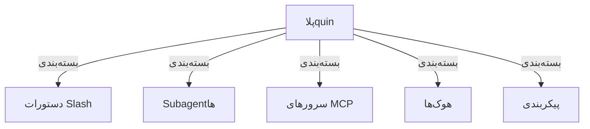

<picture>
  <source media="(prefers-color-scheme: dark)" srcset="../../resources/logos/claude-howto-logo-dark.svg">
  
</picture>

# پلاquinهای کلود کد

این دایرکتorial شامل مجموعه‌ای از مثال‌های کامل پلاquin است که قابلیت‌های مختلف کلود کد را در یک راه حل یکپارچه قابل نصب ترکیب می‌کنند.

## معرفی

پلاquinهای کلود کد مجموعه‌های قابلیت هستند که دستورات slash، subagentها، سرورهای MCP و胡ک‌ها را در یکجا قرار می‌دهند و می‌توانند با یک دستور نصب شوند. آن‌ها بالاترین سطح توسعه‌پذیری کلود کد را نشان می‌دهند و قابلیت‌های مختلف را در یک راه حل قابل به اشتراک گذاشتن و استفاده مجدد ترکیب می‌کنند.

## مروری کلی

یک پلاquin معمولاً gabliétهای زیر را در یکجا قرار می‌دهد:

- دستورات slash
- subagentها
- سرورهای MCP
-胡ک‌ها

مزیت این کار این است:

- نصب یک‌باره و استفاده از گردش کار کامل
- به اشتراک گذاشتن آسانتر در تیم
- پیکربندی‌های یکپارچه‌تر
- کنترل نسخه و توزیع آسان‌تر

## معماری پلاquin



## نوع و توزیع پلاquin

| نوع | دامنه | به اشتراک گذاشته شده برای | نگهدارنده | مثال |
|------|------|------------------|---------|------|
| رسمی | سراسری | همه کاربران | Anthropic | بازبینی PR، راهنمای امنیت |
| جامعه | عمومی | همه کاربران | جامعه | DevOps، علوم داده |
| سازمانی | داخلی | اعضای تیم | شرکت | استانداردهای داخلی، ابزارها |
| شخصی | شخصی | تک کاربر | توسعه‌دهنده | گردش کارهای سفارشی |

## ساختار تعریف پلاquin

پیمانت پلاquin در `.claude-plugin/plugin.json` با قالب JSON استفاده می‌شود:

```json
{
  "name": "my-first-plugin",
  "description": "یک پلاquin سلام",
  "version": "1.0.0",
  "author": {
    "name": "نام شما"
  },
  "homepage": "https://example.com",
  "repository": "https://github.com/user/repo",
  "license": "MIT"
}
```

## مثال ساختار پلاquin

```
my-plugin/
├── .claude-plugin/
│   └── plugin.json       # پیمانت (نام، توضیح، نسخه، نویسنده)
├── commands/             # دستورات به صورت فایل‌های Markdown
│   ├── task-1.md
│   ├── task-2.md
│   └── workflows/
├── agents/               # تعریف‌های agent سفارشی
│   ├── specialist-1.md
│   ├── specialist-2.md
│   └── configs/
├── skills/               # مهارت‌هایی با فایل SKILL.md
│   ├── skill-1/
│   │   └── SKILL.md
│   └── skill-2/
│       └── SKILL.md
├── hooks/                # پردازشگرهای رویداد در hooks.json
│   └── hooks.json
├── .mcp.json             # پیکربندی سرور MCP
├── .lsp.json             # پیکربندی سرور LSP
├── settings.json         # تنظیمات پیش‌فرض
├── templates/
│   └── issue-template.md
├── scripts/
│   ├── helper-1.sh
│   └── helper-2.py
├── docs/
│   ├── README.md
│   └── USAGE.md
└── tests/
    └── plugin.test.js
```

### پیکربندی سرور LSP

پلاquinها می‌توانند از پشتیبانی Language Server Protocol (LSP) برای هوش کد در زمان واقعی استفاده کنند. سرور LSP در هنگام نوشتن کد، تشخیص، ناوبری کد و اطلاعات نماد را ارائه می‌دهد.

**مکان پیکربندی:**
- فایل `.lsp.json` در ریشه پلاquin
- کلید لایه‌ای `lsp` در `plugin.json`

#### مرجع فیلدها

| فیلد | الزامی | توضیح |
|------|--------|----------|
| `command` | بله | فایل اجرای سرور LSP (باید در PATH باشد) |
| `extensionToLanguage` | بله | گسترش فایل را به زبان ID نقشه می‌دهد |
| `args` | خیر | آرگumerانت‌های خط فرمان سرور |
| `transport` | خیر | روش ارتباط: `stdio` (پیش‌فرض) یا `socket` |
| `env` | خیر | متغیرهای محیطی فرآیند سرور |
| `initializationOptions` | خیر | گزینه‌های ارسالی در هنگام مقداردهی اولیه LSP |
| `settings` | خیر | پیکربندی فضای کاری ارسالی به سرور |
| `workspaceFolder` | خیر | تجاوز مسیر فضای کاری |
| `startupTimeout` | خیر | حداکثر زمان انتظار برای راه‌اندازی سرور (ملی‌ثانیه) |
| `shutdownTimeout` | خیر | حداکثر زمان برای ت끄 달闭outines |
| `restartOnCrash` | خیر | در صورت crash سرور، به صورت خودکار راه‌اندازی مجدد |
| `maxRestarts` | خیر | حداکثر تعداد راه‌اندازی مجدد قبل ازريكاaftن |

#### مثال پیکربندی

**گوس (gopls):**

```json
{
  "go": {
    "command": "gopls",
    "args": ["serve"],
    "extensionToLanguage": {
      ".go": "go"
    }
  }
}
```

**پایتون (pyright):**

```json
{
  "python": {
    "command": "pyright",
    "args": ["--stdio"],
    "extensionToLanguage": {
      ".py": "python"
    }
  }
}
```

### پیکربندی سرور LSP

پلاquinها می‌توانند از پشتیبانی Language Server Protocol (LSP) برای هوش کد در زمان واقعی استفاده کنند. سرور LSP در هنگام نوشتن کد، تشخیص، ناوبری کد و اطلاعات نماد را ارائه می‌دهد.

**مکان پیکربندی:**
- فایل `.lsp.json` در ریشه پلاquin
- کلید لایه‌ای `lsp` در `plugin.json`

#### مرجع فیلدها

| فیلد | الزامی | توضیح |
|------|--------|----------|
| `command` | بله | فایل اجرای سرور LSP (باید در PATH باشد) |
| `extensionToLanguage` | بله | گسترش فایل را به زبان ID نقشه می‌دهد |
| `args` | خیر | آرگumerانت‌های خط فرمان سرور |
| `transport` | خیر | روش ارتباط: `stdio` (پیش‌فرض) یا `socket` |
| `env` | خیر | متغیرهای محیطی فرآیند سرور |
| `initializationOptions` | خیر | گزینه‌های ارسالی در هنگام مقداردهی اولیه LSP |
| `settings` | خیر | پیکربندی فضای کاری ارسالی به سرور |
| `workspaceFolder` | خیر | تجاوز مسیر فضای کاری |
| `startupTimeout` | خیر | حداکثر زمان انتظار برای راه‌اندازی سرور (ملی‌ثانیه) |
| `shutdownTimeout` | خیر | حداکثر زمان برای ت끄 달闭outines |
| `restartOnCrash` | خیر | در صورت crash سرور، به صورت خودکار راه‌اندازی مجدد |
| `maxRestarts` | خیر | حداکثر تعداد راه‌اندازی مجدد قبل ازريكاaftن |

#### مثال پیکربندی

**گوس (gopls):**

```json
{
  "go": {
    "command": "gopls",
    "args": ["serve"],
    "extensionToLanguage": {
      ".go": "go"
    }
  }
}
```

**پایتون (pyright):**

```json
{
  "python": {
    "command": "pyright",
    "args": ["--stdio"],
    "extensionToLanguage": {
      ".py": "python"
    }
  }
}
```

### نصب پلاquinها

#### از مسیر محلی

```bash
# نصب از مسیر محلی
claude --plugin-dir ./path/to/plugin-directory
```

### از GitHub نصب

```bash
/plugin marketplace add username/repo                    # اضافه کردن مخزن GitHub به عنوان مارکت
/plugin install plugin-name@marketplace-name             # سپس نصب پلاquin از آن مارکت
/plugin install plugin-name --marketplace username/repo  # یا انجام هم‌زمان هر دو (v2.1.275+)
```

### فهرست پلاquin‌های نصب شده

```bash
/plugin list             # همه پلاquin‌های نصب شده
/plugin list --enabled   # فقط پلاquin‌های فعال
/plugin list --disabled  # فقط پلاquin‌های غیرفعال
```

### به‌روزرسانی پلاquin

از فرمت CLI استفاده شود — این فرمت در [`plugin update`](https://code.claude.com/docs/en/plugins-reference) ثبت شده است، و همچنین زمانی که به‌روزرسانی در دسترس باشد کلود کد از شما می‌خواهد از آن استفاده کنید:

```bash
claude plugin update plugin-name
```

### غیرفعال / فعال کردن پلاquin

```bash
# غیرفعال‌سازی موقت
/plugin disable plugin-name

# فعال‌سازی مجدد
/plugin enable plugin-name
```

### حذف کردن پلاquin

```bash
/plugin uninstall plugin-name
```

## مفاهیم مرتبط

قابلیت‌های زیر کلود کد با پلاquinها همکاری می‌کنند:

- **[دستورات Slash](../01-slash-commands/README.md)** - دستورات جداگانه بسته‌بندی شده در پلاquin
- **[حافظه](../02-memory/README.md)** - contexte پایدار پلاquin
- **[مهارت‌ها](../03-skills/README.md)** - قابلیت‌های stromal که می‌توانند در پلاquin بسته شوند
- **[Subagentها](../04-subagents/README.md)** - agentهای تخصصی که به عنوان اجزای پلاquin شامل می‌شوند
- **[سرورهای MCP](../05-mcp/README.md)** - یکپارچگی‌های MCP بسته‌بندی شده در پلاquin
- **[هوک‌ها](../06-hooks/README.md)** - پردازشگرهای رویداد که گردش کار پلاquin را فعال می‌کنند


## گردش کار کامل مثالی

### گردش کار کامل پلاquin بازبینی PR

```
1. کاربر: /review-pr

2. پلاquin اجرا می‌کند:
   ├──胡ک pre-review.js گنجینه git را تایید می‌کند
   ├── سرور MCP GitHub داده‌های PR را دریافت می‌کند
   ├── Subagent security-reviewer امنیت را تحلیل می‌کند
   ├── Subagent test-checker پوشش تست را تایید می‌کند
   └── Subagent performance-analyzer عملکرد را بررسی می‌کند

3. جمع‌آوری و نمایش نتایج:
   ✅ امنیت: مشکلی پیدا نشد
   ⚠️  تست: پوشش ۶۵٪ (پیشنهاد ۸۰٪+)
   ✅ عملکرد: تأثیری penting نیست
   📝 ۱۲ پیشنهاد ارائه شد
```

## عیب‌یابی

### پلاquin نصب نمی‌شود

- بررسی سازگاری نسخه کلود کد: `claude --version`
- اعتبارسنجی نحوی `plugin.json` با یک GitHub Schema
- بررسی اتصال شبکه (پلاquin‌های از راه دور)
- بررسی مجوز: `ls -la plugin/`

### اجزا بارگذاری نمی‌شوند

- تأیید مسیرها در `plugin.json` با ساختار دایرکتوری واقعی مطابقت دارند
- بررسی مجوز فایل: `chmod +x scripts/`
- بررسی نحوی فایل‌های componente
- مشاهده فهرست componente: `claude plugin details plugin-name`

### اتصال MCP شکست می‌خورد

- تأیید متغیرهای محیطی صحیح تنظیم شده‌اند
- بررسی نصب و وضعیت سلامت سرور MCP
- از `/mcp` برای مشاهده وضعیت سرورهای MCP استفاده کنید
- مشاهده پیکربندی MCP در پوشه `mcp/`

### دستورات پس از نصب در دسترس نیستند

- تأیید نصب موفقیت‌آمیز پلاquin: `/plugin list`
- بررسی فعال بودن پلاquin: `/plugin list --enabled`
- تأیید اینکه فعال شده است — به بخش [نحوه نصب](#نحوه-نصب) مراجعه کنید: `Plugin is now active.` نشان می‌دهد نیازی به عملیات دیگری نیست، `Run /reload-plugins to activate.` نشان می‌دهد دستور را اجرا کنید (بدون نیاز به راه‌اندازی مجدد)
- بررسی تداخل با دستورات موجود

### مشکل اجرای胡ک

- تأیید مجوزهای فایل胡ک صحیح هستند
- بررسی نحوی胡ک و نام رویداد
- بررسی لاگ‌های胡ک برای جزئیات خطا
- در صورت امکان،胡کها را به صورت دستی تست کنید

## منابع بیشتر

- [مستندات رسمی پلاquin](https://code.claude.com/docs/en/plugins)
- [کشف پلاquin](https://code.claude.com/docs/en/discover-plugins)
- [مارکت پلاquin](https://code.claude.com/docs/en/plugin-marketplaces)
- [مرجع پلاquin](https://code.claude.com/docs/en/plugins-reference)
- [مرجع سرور MCP](https://modelcontextprotocol.io/)
- [راهنمای پیکربندی Subagent](../04-subagents/README.md)
- [مرجع سیستم胡ک‌ها](../06-hooks/README.md)

---

**آخرین به‌روزرسانی**: ۱۸ آبان ۲۰۲۶
**نسخه کلود کد**: ۲.۱.۳۰۲
**منبع**:
- https://code.claude.com/docs/en/discover-plugins
- https://code.claude.com/docs/en/plugins-reference
- https://code.claude.com/docs/en/settings
- https://code.claude.com/docs/en/plugins/install
- https://code.claude.com/docs/en/plugins/cli-reference
- https://code.claude.com/docs/en/plugins/manifest-reference
- https://code.claude.com/docs/en/plugins/marketplace-reference
- https://code.claude.com/docs/en/plugins/components
- https://code.claude.com/docs/en/plugins/publish
- https://code.claude.com/docs/en/plugins/overview
