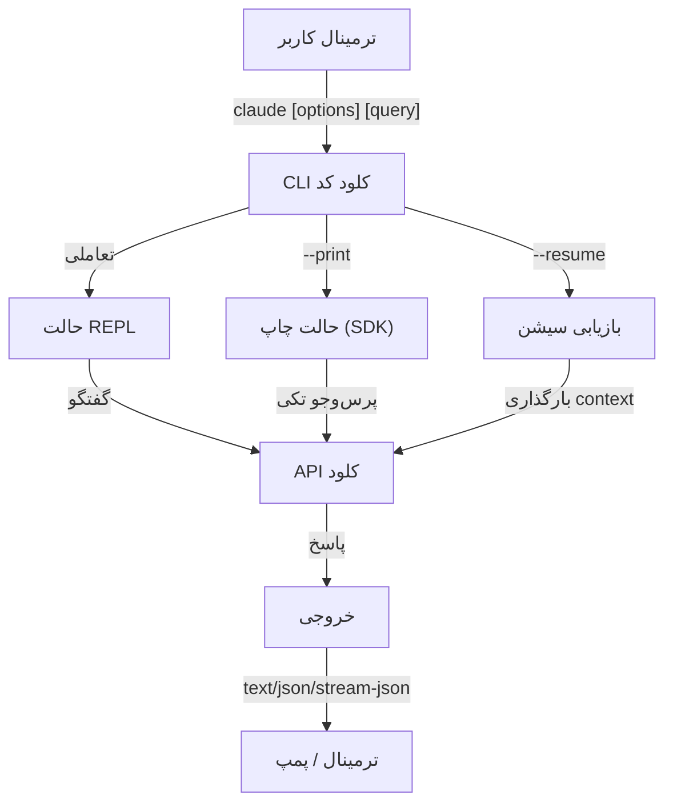

<picture>
  <source media="(prefers-color-scheme: dark)" srcset="../../resources/logos/claude-howto-logo-dark.svg">
  
</picture>

# مرجع CLI

## مرور کلی

CLI (رابط خط فرمان) کلود کد، روش اصلی برای تعامل با کلود کد است. پارامترهای و دستورات قدرتمند آن برای اجرای پرس‌وجو، مدیریت سیشن، انتخاب مدل و یکپارچگی کلود کد در گردش‌کارهای توسعه شما فراهم می‌کند.

## معماری



## دستورات CLI

| دستور | توضیح | مثال |
|---------|-------------|---------|
| `claude` | راه‌اندازی REPL تعاملی | `claude` |
| `claude "query"` | launch REPL با پرامپت اولیه | `claude "توضیح این پروژه"` |
| `claude -p "query"` | حالت چاپ، پرس‌وجو و خروج | `claude -p "توضیح این تابع"` |
| `cat file \| claude -p "query"` | پردازش ادرس ورودی از طریق کانال | `cat logs.txt \| claude -p "توضیح این لاگ‌ها"` |
| `claude -c` | ادامه به سیشن اخیر | `claude -c` |
| `claude -c -p "query"` | ادامه یافتن در حالت چاپ | `claude -c -p "بررسی خطاهای تایپ"` |
| `claude -r "<session>" "query"` | بازیابی سیشن با ID یا نام | `claude -r "auth-refactor" "پایان این PR"` |

---

## پرچم‌های اصلی

| پرچم | توضیح | مثال |
|------|-------------|---------|
| `-p、--print` | بدون ورود به حالت تعاملی، خروجی را مستقیماً چاپ کنید | `claude -p "query"` |
| `-c、--continue` | بارگذاری به سیشن اخیر | `claude --continue` |
| `-r、--resume` | بازیابی سیشن مشخص شده با ID یا نام | `claude --resume auth-refactor` |
| `-v、--version` | چاپ شماره نسخه | `claude -v` |
| `-w、--worktree` | شروع در کارخونه مجزایتلاف بومی | `claude -w` |
| `-n、--name` | تنظیم نام نمایش سیشن | `claude -n "auth-refactor"` |
| `--from-pr <number>` | بازیابی سیشن مرتبط با GitHub PR | `claude --from-pr 42` |
| `--cloud [description\|session_id\|url]` | با وصف داده‌شده در claude.ai یک سیشن ابری ایجاد کرده یا از طریق session ID/claude.ai/code URL به یک سیشن موجود متصل شوید | `claude --cloud "implement API"` |
| `--remote "task"` | **استعارت منسوخ‌شده‌ی `--cloud`** (از جمله دسترسی به سیشن‌های موجود). به جای آن `--cloud` را استفاده کنید | `claude --remote "implement API"` |
| `--remote-control、--rc` | ورود به سیشن تعاملی از کنترل از راه دور | `claude --rc` |
| `--teleport` | بازیابی سیشن وب به محلی | `claude --teleport` |
| `--teammate-mode` | حالت نمایش کار تیمی | `claude --teammate-mode tmux` |
| `--bare` | حالت صرف‌کردنی، همه‌پرسی‌های شکننده را رد می‌کند (hookها، مهارت‌ها، پلاquinها، MCP، حافظه خودکار و `CLAUDE.md`) | `claude --bare` |
| `--enable-auto-mode` | قابلیت حالت مجوز خودکار را فعال می‌کند | `claude --enable-auto-mode` |
| `--channels` | اشتراک‌گذاری پلاquin کانتینر MCP. هر مورد باید به صورت `plugin:<name>@<marketplace>` ذکر شود؛ فقط نوشتن نام رد می‌شود | `claude --channels plugin:discord@my-marketplace` |
| `--chrome / --no-chrome` | فعال/غیرفعال کردن یکپارچگی مرورگر Chrome | `claude --chrome` |
| `--effort` | تنظیم شدت استدلال | `claude --effort high` |
| `--init / --init-only` | `--init` قبل از شروع سیشن، اجرا می‌کند Setup hooks، فقط در حالت چاپ؛ `--init-only` اجرای Setup و SessionStart hooks | `claude --init-only` |


| دستور | توضیح | مثال |
|---------|-------------|---------|
| `claude update` | به‌روزرسانی به آخرین نسخه | `claude update` |
| `claude mcp` | پیکربندی سرورهای MCP | به [مستندات MCP](../05-mcp/README.md) مراجعه کنید |
| `claude mcp serve` | کلود کد را به عنوان MCP server اجرا کنید | `claude mcp serve` |
| `claude agents` | لیست subagents پیکربندی شده | `claude agents` |
| `claude auto-mode defaults` | مدل‌های پیش‌فرض حالت خودکار را به صورت JSON چاپ کنید | `claude auto-mode defaults` |
| `claude remote-control` | سرور کنترل از راه دور را راه‌اندازی کنید (حالت سرور، بدون سیشن تعاملی محلی؛ ظرفیت از ۳۲ پیش‌فرض) | `claude remote-control --name "My Project"` |
| `claude --remote-control [name]` | شروع سیشن تعاملی فعال شده از کنترل از راه دور (نام مستعار `--rc`) | `claude --rc` |
| `claude plugin` | مدیریت پلاquinها (نصب، فعال‌سازی، غیرفعال‌سازی) | `claude plugin install my-plugin` |
| `claude auth login` | ورود (پشتیبانی از `--email`، `--sso`) | `claude auth login --email user@example.com` |
| `claude auth logout` | خروج از حساب جاری | `claude auth logout` |
| `claude auth status` | بررسی وضعیت ورود (0 معتبر، ۱ نامعتبر) | `claude auth status` |

---

## مثال‌های کاربردی

### کاربرد‌های روزمره

```bash
# سیشن تعاملی
claude

# پرس‌وجو سریع
claude -p "explain this repo"

# ادامه‌های اخیر
claude -c

# بررسی فایل
claude -p "review README.md"

# JSON برای اسکریپت
claude -p --output-format json "list all classes"
```

---

## ترکیب پرچم‌ها

```bash
# مرور فقط‌خواندنی
claude --permission-mode plan -p "review this codebase"

# مدل پیشرفته + خروجی JSON
claude --model opus -p --output-format json "analyze architecture"

# دایرکتوری کاری سفارشی + MCP
claude --working-directory ./backend --mcp-config ./mcp.json
```

---

## مدل‌ها

### انتخاب مدل

```bash
# استفاده از نام‌های کوتاه
claude --model sonnet
claude --model opus
claude --model haiku

# استفاده از opusplan alias (Opus برای برنامه‌ریزی و Sonnet برای اجرا)
claude --model opusplan "design and implement the caching layer"

# تغییر به حالت speed در جلسه
claude --model haiku --effort low
```

### سطوح effort (Opus 4.6)

```bash
# تنظیم effort از طریق پارامتر CLI
claude --model opus --effort high "design the architecture"

# تنظیم effort از طریق دستور Slash
/effort max

# تنظیم effort از طریق متغیر محیطی
CLAUDE_EFFORT=medium claude --model opus
```

---

## متغیرهای محیطی رایج

| متغیر محیطی | توضیح |
|------|------|
| `ANTHROPIC_API_KEY` | کلید API |
| `CLAUDE_MODEL` | مدل پیش‌فرض |
| `CLAUDE_EFFORT` | شدت پیش‌فرض استدلال |
| `CLAUDE_WORKING_DIRECTORY` | دایرکتوری کاری پیش‌فرض |
| `CLAUDE_OUTPUT_FORMAT` | فرمت خروجی پیش‌فرض |
| `CLAUDE_MCP_CONFIG` | پیکربندی MCP پیش‌فرض |

---

## عیب‌یابی

### دستور پیدا نشد

- تایید اینکه `claude` نصب شده و در PATH است
- دوباره باز کردن ترمینال
- بررسی اینکه نیاز به ورود مجدد یا به‌روزرسانی است

### مشکل API Key

- بررسی `ANTHROPIC_API_KEY`
- تایید DecryptKey از آن گذشته نمی‌شود
- بررسی که شبکه به API قابل دسترس است

### سیشن پیدا نشد

- تایید نام یا شناسه سیشن صحیح است
- اول `claude --list-sessions` را اجرا کنید (اگر نسخه شما پشتیبانی می‌کند)
- بررسی برای مطابقت با حساب جاری

### مشکلات فرمت خروجی

- اطمینان حاصل کنید خروجی قابل تجزیه در `--output-format json` است
- اگر جاری است، `--include-partial-messages` را اضافه کنید

### مجوز رد شد

- بررسی `--permission-mode`
- بررسی `--allowedTools` و `--disallowedTools`
- در صورت نیاز، به‌صورت صریح ابزارهایی که نیاز است، اجازه دهید

### نمونه‌های پرکاربرد

```bash
# یافتن و مدیریت اتصالات مکرر
claude --remote-control

# استفاده از worktree
claude -w

# استفاده از 시가총액 mode
claude --permission-mode plan -p "analyze this codebase"
```

---

## منابع بیشتر

- [راهنمای ریشه](../README.md)
- [مرجع دستورات Slash](../01-slash-commands/README.md)
- [مستندات MCP](../05-mcp/README.md)
- [مستندات رسمی CLI کلود کد](https://code.claude.com/docs/en/cli-reference)

---

**آخرین به‌روزرسانی**: ۱۸ آبان ۲۰۲۶
**نسخه کلود کد**: ۲.۱.۳۰۲
**منبع**:
- https://code.claude.com/docs/en/cli-reference
- https://code.claude.com/docs/en/headless
- https://platform.claude.com/docs/en/about-claude/models/overview
- https://code.claude.com/docs/en/model-config
- https://code.claude.com/docs/en/remote-control
