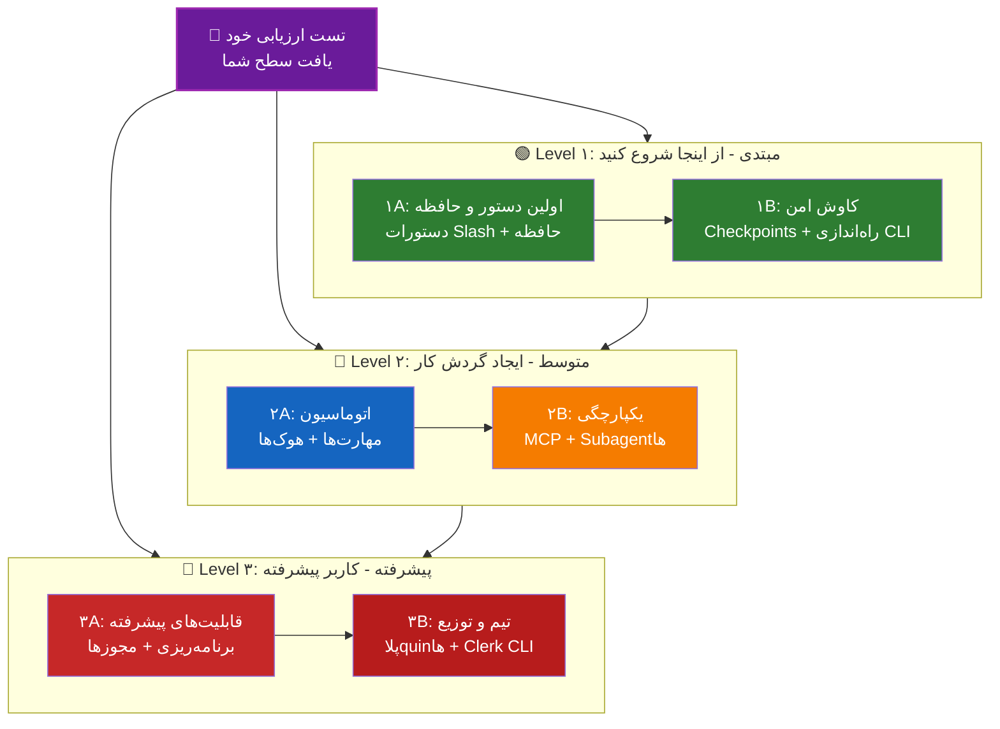

<picture>
  <source media="(prefers-color-scheme: dark)" srcset="../resources/logos/claude-howto-logo-dark.svg">
  
</picture>

# 📚 نقشه راه یادگیری کلود کد

**با کلود کد آشنایی ندارید؟** این راهنما به شما کمک می‌کند تا با سرعت خود، قابلیت‌های کلود کد را بیاموزید. چه تازه‌کار باشید چه توسعه‌دهنده حرفه‌ای، ابتدا از تست ارزیابی خود زیر استفاده کنید تا بهترین نقطه شروع را پیدا کنید.

---

## 🧭 یافتن سطح خود

نقطه شروع هر کسی متفاوت است. ابتدا یک ارزیابی خود سریع انجام دهید تا بهترین ورودی را برای خود تایید کنید.

**لطفاً به صورت صادقانه به سوالات زیر پاسخ دهید:**

- [ ] من می‌توانم کلود کد را راه‌اندازی کرده و با آن صحبت کنم (`claude`)
- [ ] من فایل `CLAUDE.md` را ایجاد یا ویرایش کرده‌ام
- [ ] من حداقل ۳ دستور Slash داخلی استفاده کرده‌ام (مثلاً `/help`، `/compact`، `/model`)
- [ ] من دستور Slash یا مهارت سفارشی ایجاد کرده‌ام (`SKILL.md`)
- [ ] من یک سرور MCP پیکربندی کرده‌ام (مثلاً GitHub، پایگاه داده)
- [ ] من در `~/.claude/settings.json` هوک‌ها را تنظیم کرده‌ام
- [ ] من subagent سفارشی ایجاد یا استفاده کرده‌ام (`.claude/agents/`)
- [ ] من از حالت چاپ (`claude -p`) برای اسکریپت یا CI/CD استفاده کرده‌ام

**سطح شما:**

| تعداد تیک | سطح | از کجا شروع شود | زمان اتمام |
|--------|-------|----------|------------------|
| ۰-۲ | **Level ۱: مبتدی** - از اینجا شروع کنید | [مارک ۱A](#مرکب-۱a-اولین-دستور-و-حافظه) | حدود ۳ ساعت |
| ۳-۵ | **Level ۲: متوسط** - ایجاد گردش کار | [مارک ۲A](#مرکب-۲a-اتوماسیون-مهارت‌ها-و-هوک‌ها) | حدود ۵ ساعت |
| ۶-۸ | **Level ۳: پیشرفته** - کاربر پیشرفته و مسئول تیم | [مارک ۳A](#مرکب-۳a-ویژگی‌های-پیشرفته) | حدود ۵ ساعت |

> **نکته**: اگر مطمئن نیستید، بهتر است از سطح پایین‌تر شروع کنید. بازبینی محتوای آشناست، همیشه بهتر از از دست دادن مفاهیم پایه است.

> **نسخه تعاملی**: در کلود کد دستور `/self-assessment` را اجرا کنید تا یک تست تعاملی و راهنمایی‌شده دریافت کنید، کهAll ۱۰ حوزه قابلیت را پوشش می‌دهد و یک مسیر یادگیری شخصی تولید می‌کند.

---

## 🎯 فلسفه یادگیری

پوشه‌های این مخزن بر اساس **ترتیب یادگیری پیشنهادی** شماره‌گذاری شده‌اند، پشت سر ۳ اصل:

۱. **وابستگی‌ها** - ابتدا مفاهیم پایه را یاد بگیرید
۲. **پیچیدگی** - ابتدا قابلیت‌های ساده، سپس قابلیت‌های پیشرفته
۳. **سام بکارگیری-frequency** - ابتدا قابلیت‌های رایج‌ترین

این رویکرد به شما کمک می‌کند در کنار کسب سود عملیاتی سریع، پایه قوی بسازید.

---

## 🗺️ مسیر یادگیری شما

**توضیح رنگ‌ها:**
- 💜 بنفش: تست ارزیابی خود
- 🟢 سبز: مسیر Level ۱ - مبتدی
- 🔵 آبی / 🟡 طلایی: مسیر Level ۲ - متوسط
- 🔴 سرخ: مسیر Level ۳ - پیشرفته

---

## 📊 جدول کامل نقشه راه

| گام | قابلیت | پیچیدگی | زمان | سطح | وابستگی | چرا بیاموزید | فاید کلیدی |
|------|---------|-----------|------|-------|--------------|----------------|--------------|
| **۱** | [دستورات Slash](01-slash-commands/README.md) | ⭐ مبتدی | ۳۰ دقیقه | Level ۱ | هیچ | افزایش سریع بهره‌وری (۵۵+ دستور داخلی + skillهای بسته‌بندی شده) | اتوماسیون فوری، استانداردسازی تیمی |
| **۲** | [حافظه](02-memory/README.md) | ⭐⭐ مبتدی+ | ۴۵ دقیقه | Level ۱ | هیچ | پایه همه قابلیت‌ها | contexte پایدار، تنظیمات ترجیحی |
| **۳** | [Checkpoints](08-checkpoints/README.md) | ⭐⭐ متوسط | ۴۵ دقیقه | Level ۱ | مدیریت peril.session | کاوش امن | آزمایش، بازیابی |
| **۴** | [راه‌اندازی CLI](10-cli/README.md) | ⭐⭐ مبتدی+ | ۳۰ دقیقه | Level ۱ | هیچ | کاربرد اصلی CLI | حالت تعاملی و حالت چاپ |
| **۵** | [مهارت‌ها](03-skills/README.md) | ⭐⭐ متوسط | ۱ ساعت | Level ۲ | دستورات Slash | اتوماسیون قابلیت‌های حرفه‌ای | قابلیت‌های قابل استفاده مجدد، یکپارچگی |
| **۶** | [هوک‌ها](06-hooks/README.md) | ⭐⭐ متوسط | ۱ ساعت | Level ۲ | ابزارها، دستورات | اتوماسیون گردش کار (۳۳ رویداد، ۵ نوع) | اعتبارسنجی، درگاه کیفیت |
| **۷** | [MCP](05-mcp/
