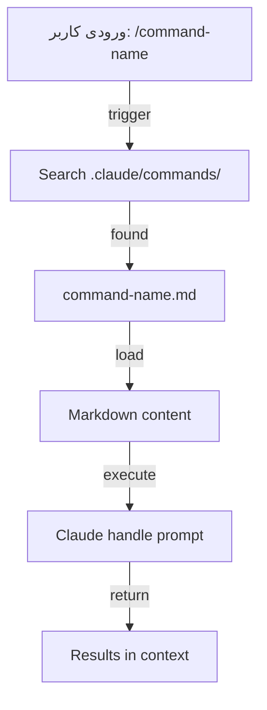
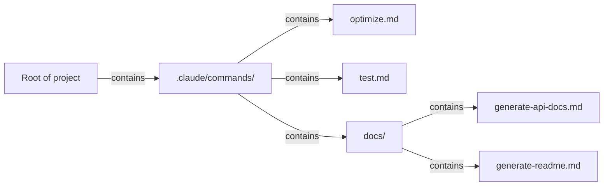

<picture>
  <source media="(prefers-color-scheme: dark)" srcset="../resources/logos/claude-howto-logo-dark.svg">
  
</picture>

# رهنمای کامل مفاهیم کلود کد

این دفترچه مرجع جامعی است که Slash Commands، Subagents، Memory، MCP Protocol، Agent Skills، Plugins، Hooks، Checkpoints، Advanced Features و سایر مفاهیم کلود کد را پوشش می‌دهد و همراه با جداول، نمودارها و مثال‌های عملی است.

## فهرست مطالب

1. [دستورات Slash](#slash-commands)
2. [Subagents](#subagents)
3. [Memory](#memory)
4. [نCoderلوك PMC Protocol](#mcp-protocol)
5. [مهارت‌های Agent](#agent-skills)
6. [پلاquinها](#claude-code-plugins)
7. [هوک‌ها](#hooks)
8. [Checkpointها و Rewind](#checkpoints-and-rewind)
9. [ویژگی‌های پیشرفته](#advanced-features)
10. [مقایسه و یکپارچه‌سازی](#comparison--integration)

---

## دستورات Slash

### مرور کلی

دستورات Slash، دستورهای کوتاه هستند که کاربر به صورت دستی شروع می‌کنند، به صورت فایل‌های Markdown ذخیره می‌شوند و کلود کد می‌تواند آن‌ها را بخواند و اجرا کند. برای استاندارد کردن پرامپت‌های با فراوان و چرخه‌های کاری عادی، بسیار مناسبی هستند، از سوی کاربران، برای تعمیم این روش‌ها در تیم‌ها.

### معماری



### ساختار فایل



### جدول سازمان‌یابی دستورات

| مکان | دامنه | محدوده در دسترس | سناریو کاربرد | ردیابی Git |
|------|--------|------------------|----------------|-------------|
| `.claude/commands/` | سطوح پروژه | اعضای تیم | گردش‌کار تیمی، استانداردهای مشترک | ✅ بله |
| `~/.claude/commands/` | سطوح کاربری | کاربر فعلی | دستورات سریع شخصی از پروژه‌ای به دیگر | ❌ خیر |
| Subdirectories | فضای نام‌گذاری | بسته به پدر | سازمان‌یابی دستورات بر اساس دامنه | ✅ بله |

### قابلیت‌ها و توانایی‌ها

| قابلیت | مثال | پشتیبانی می‌کند؟ |
|--------|------|------------------|
| اجرا اسکریپت‌های Sh | `bash scripts/deploy.sh` | ✅ بله |
| ارجاع فایل | `@path/to/file.js` | ✅ بله |
| یکپارچگی Bash | `$(git log --oneline)` | ✅ بله |
| آرگومان‌ها | `/pr --verbose` | ✅ بله |
| دستور MCP | `/mcp__github__list_prs` | ✅ بله |

### مثال‌های عملی

#### مثال ۱: دستور بهینه‌سازی کد

**فایل**: `.claude/commands/optimize.md`

```markdown
---
name: بهینه‌سازی کد
description: تحلیل مشکلات عملکردی و پیشنهاد بهینه‌سازی
tags: performance, analysis
---

# تحلیل کد

بر اساس اولویت‌های زیر، مسائل کد را بررسی کنید:

۱. **ظرفیت‌های عملکردی** - شناسایی عملیات O(n²) و حلقه‌های ناکارآمد
۲. **ر شیرش حافظه** - یافتن منابع آزاد نشده، ارجاعات دایره‌ای
۳. **بهبود الگوریتم** - پیشنهاد بهتر
... (truncated) ...


```markdown
---
name: بهینه‌سازی کد
description: تحلیل مشکلات عملکردی و پیشنهاد بهینه‌سازی
tags: performance, analysis
---

# تحلیل و بهینه‌سازی کد

بر اساس اولویت‌های زیر، مسائل کد را بررسی کنید:

۱. **نقطه‌های عملکردی** - شناسایی عملیات O(n²) و حلقه‌های ناکارآمد
۲. **ناآșس‌اند حافظه** - یافتن منابع آزادنشده، ارجاعات دایره‌ای
۳. **بهبود الگوریتم** - پیشنهاد الگوریتم یا ساختار داده بهتر
۴. **فرصت‌های کش** - شناسایی محاسبات تکراری
۵. **مشکلات همزمانی** - شناسایی شرایط رقابت یا مشکلات thread

خروجی را به این فرمت ارائه دهید:
- شدت مشکل (Critical/High/Medium/Low)
- مکان کد
- توضیح
- راه‌حل پیشنهادی همراه با مثال کد
```

**استفاده:**

```bash
# کاربر در کلود کد ورودی می‌دهد
/optimize

# کلود کد محتوا را بارگذاری می‌کند و منتظر کد می‌ماند
```

---

#### مثال ۲: دستور آماده‌سازی Pull Request

**فایل**: `.claude/commands/pr.md`

```markdown
---
name: آماده‌سازی Pull Request
description: پاک‌سازی کد، استیج کردن تغییرات و آماده‌سازی یک Pull Request
tags: git, workflow
---

# فهرست آماده‌سازی Pull Request

قبل از ایجاد PR، مراحل زیر را انجام دهید:

۱. اجرای فرمت‌سازی: `prettier --write .`
۲. اجرای تست‌ها: `npm test`
۳. مشاهده git diff: `git diff HEAD`
۴. استیج کردن تغییرات: `git add .`
۵. ایجاد پیام commit با قوانین conventional commits:
  - `fix:` رفع باگ
  - `feat:` ویژگی جدید
  - `docs:` مستندات
  - `refactor:` بازسازی کد
  - `test:` تست‌های جدید
  - `chore:` نگهداری

۶. تولید خلاصه PR که شامل موارد زیر باشد:
  - چه چیزی تغییر کرد
  - چرا تغییر کرد
  - چه تست‌هایی انجام شد
  - پیامدهای احتمالی
```

**استفاده:**

```bash
/pr

# کلود کد لیست را از بالا به پایین بررسی می‌کند و PR را آماده می‌کند
```

---

## Slash Commands vs دیگر قابلیت‌ها

| قابلیت | روش فعال‌سازی | سناریو براساس کاربرد |
|--------|----------------------|
| **Skill‌ها** | خودکار / نیمه‌خودکار | قابلیت‌های قابل استفاده مجدد، استانداردسازی گردش کار |
| **دستورات Slash** | دستی | دستورات سریع |
| **Subagentها** | خودکار محتمل | تکمیل وظایف از طریق فراخوانی |


---
```

with open(os.path.join(fa_dir, "claude_concepts_guide.md"), "a", encoding="utf-8") as f:
    f.write(content)
print("claude_concepts_guide.md part 2 written!")


```markdown
# مستندات API

## GET /api/v1/users/:id

### توضیح
توضیح کوتاه درباره‌ی این Endpoint

### پارامترها

| نام | نوع | الزامی | توضیح |
|------|-----|--------|-------|
| id | string | بله | شناسه کاربر |

### پاسخ

**۲۰۰ OK**

```json
{
  "id": "usr_123",
  "name": "John Doe",
  "email": "john@example.com",
  "created_at": "2025-01-15T10:30:00Z"
}
```

**۴۰۴ پیدا نشد**

```json
{
  "error": "USER_NOT_FOUND",
  "message": "User does not exist"
}
```

### مثال

**cURL**

```bash
curl -X GET "https://api.example.com/api/v1/users/usr_123"   -H "Authorization: Bearer YOUR_TOKEN"
```

**JavaScript**

```javascript
const user = await fetch('/api/v1/users/usr_123', {
  headers: { 'Authorization': 'Bearer token' }
}).then(r => r.json());
```

**Python**

```python
response = requests.get(
    'https://api.example.com/api/v1/users/usr_123',
    headers={'Authorization': 'Bearer token'}
)
user = response.json()
```
```

---

## مثال‌های عملی Slash Commands

#### مثال ۲: دستور آماده‌سازی Pull Request

**فایل**: `.claude/commands/pr.md`

```markdown
---
name: آماده‌سازی Pull Request
description: پاک‌سازی کد، استیج کردن تغییرات و آماده‌سازی یک Pull Request
tags: git, workflow
---

# لیست آماده‌سازی Pull Request

قبل از ایجاد PR، مراحل زیر را انجام دهید:

۱. اجرای فرمت‌سازی: `prettier --write .`
۲. اجرای تست‌ها: `npm test`
۳. مشاهده git diff: `git diff HEAD`
۴. استیج کردن تغییرات: `git add .`
۵. ایجاد پیام commit با قوانین conventional commits:
  - `fix:` رفع باگ
  - `feat:` ویژگی جدید
  - `docs:` مستندات
  - `refactor:` بازسازی کد
  - `test:` تست‌های جدید
  - `chore:` نگهداری

۶. تولید خلاصه PR که شامل موارد زیر باشد:
  - چه چیزی تغییر کرد
  - چرا تغییر کرد
  - چه تست‌هایی انجام شد
  - پیامدهای احتمالی
```

**استفاده:**

```bash
/pr

# کلود کد لیست را از بالا به پایین بررسی می‌کند و PR را آماده می‌کند
```

---

## دستورات Slash در برابر قابلیت‌های دیگر

| قابلیت | روش فعال‌سازی | سناریو براساس کاربرد |
|--------|----------------------|
| **Skill‌ها** | خودکار / نیمه‌خودکار | قابلیت‌های قابل استفاده مجدد، استانداردسازی گردش کار |
| **دستورات Slash** | دستی | دستورات سریع |
| **Subagentها** | خودکار محتمل | تکمیل وظایف با فراخوانی |

---

## دستورات Slash در برابر قابلیت‌های دیگر

| قابلیت | روش فعال‌سازی | سناریو براساس کاربرد |
|--------|----------------------|
| **Skill‌ها** | خودکار / نیمه‌خودکار | قابلیت‌های قابل استفاده مجدد، استانداردسازی گردش کار |
| **دستورات Slash** | دستی | دستورات سریع |
| **Subagentها** | خودکار محتمل | تکمیل وظایف با فراخوانی |

---

## Slash Commands vs دیگر قابلیت‌ها

| قابلیت | روش فعال‌سازی | سناریو براساس کاربرد |
|--------|----------------------|
| **Skill‌ها** | خودکار / نیمه‌خودکار | قابلیت‌های قابل استفاده مجدد، استانداردسازی گردش کار |
| **دستورات Slash** | دستی | دستورات سریع |
| **Subagentها** | خودکار محتمل | تکمیل وظایف با فراخوانی |

---

## مثال‌های عملیSlash Commands

### مثال ۱: دستور بهینه‌سازی کد

**فایل**: `.claude/commands/optimize.md`

```markdown
---
name: بهینه‌سازی کد
description: تحلیل مشکلات عملکردی و پیشنهاد بهینه‌سازی
tags: performance, analysis
---

# تحلیل و بهینه‌سازی کد

برای بهینه‌سازی، مسائل را با اولویت بررسی کنید:

۱. **جلوگیری از عملکرد** - شناسایی عملیات O(n²) و حلقه‌های ناکارآمد
۲. **ناآشم حافظه** - یافتن منابع آزادنشده، ارجاعات دایره‌ای
۳. **بهبود الگوریتم** - پیشنهاد الگوریتم یا ساختار داده بهتر
۴. **فرصت‌های کش** - شناسایی محاسبات تکراری
۵. **مشکلات همزمانی** - شناسایی شرایط رقابت یا مشکلات thread

خروجی را به این فرمت ارائه دهید:
- شدت مشکل (Critical/High/Medium/Low)
- مکان کد
- توضیح
- راه‌حل پیشنهادی همراه با مثال کد
```

**استفاده:**

```bash
# کاربر در کلود کد پرامپت می‌دهد
/optimize

# کلود کد محتوا را بارگذاری می‌کند و منتظر کد می‌ماند
```

---

### مثال ۲: دستور آماده‌سازی Pull Request

**فایل**: `.claude/commands/pr.md`

```markdown
---
name: آماده‌سازی Pull Request
description: پاک‌سازی کد، استیج کردن تغییرات و آماده‌سازی یک Pull Request
tags: git, workflow
---

# لیست آماده‌سازی Pull Request

قبل از ایجاد PR، مراحل زیر را انجام دهید:

۱. اجرای فرمت‌سازی: `prettier --write .`
۲. اجرای تست‌ها: `npm test`
۳. مشاهده git diff: `git diff HEAD`
۴. استیج کردن تغییرات: `git add .`
۵. ایجاد پیام commit با قوانین conventional commits:
  - `fix:` رفع باگ
  - `feat:` ویژگی جدید
  - `docs:` مستندات
  - `refactor:` بازسازی کد
  - `test:` تست‌های جدید
  - `chore:` نگهداری

۶. تولید خلاصه PR که شامل موارد زیر باشد:
  - چه چیزی تغییر کرد
  - چرا تغییر کرد
  - چه تست‌هایی انجام شد
  - پیامدهای احتمالی
```

**استفاده:**

```bash
/pr

# کلود کد لیست را از بالا به پایین بررسی می‌کند و PR را آماده می‌کند
```
```

with open(os.path.join(fa_dir, "claude_concepts_guide.md"), "a", encoding="utf-8") as f:
    f.write(content)
print("claude_concepts_guide.md part 3 written!")
