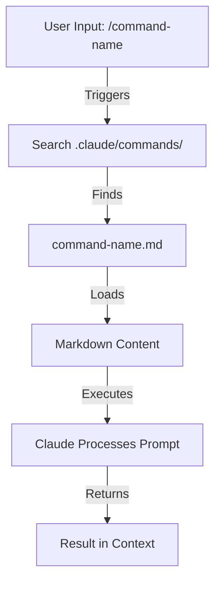

<picture>
  <source media="(prefers-color-scheme: dark)" srcset="resources/logos/claude-howto-logo-dark.svg">
  
</picture>

# راهنمای کامل مفاهیم Claude

یک مرور مفهومی از نحوه کار ویژگی‌های کد کلود و چگونگی fit شدن آن‌ها — دیاگرام‌های architecture، جداول تصمیم و مقایسه‌ها در Slash Commands، Subagents، Memory، MCP، Skills، Plugins، Hooks و موارد دیگر.

> **نحوه استفاده از این راهنما**: این صفحه *مفاهیم* را توضیح می‌دهد — هر ویژگی چیست، چگونه داخلی کار می‌کند و چه زمانی به آن مراجعه کنید. **قالب‌های copy-paste و متریال reference کامل در ماژول‌های numbered** (`01-` تا `10-`) قرار دارند که هر بخش به آن‌ها لینک می‌دهد. اینجا شروع کنید تا یک mental model بسازید، سپس به ماژول بروید تا چیزی را پیکربندی کنید.

---

## فهرست مطالب

1. [Slash Commands](#slash-commands) — [module](01-slash-commands/)
2. [Subagents](#subagents) — [module](04-subagents/)
3. [Memory](#memory) — [module](02-memory/)
4. [MCP Protocol](#mcp-protocol) — [module](05-mcp/)
5. [Agent Skills](#agent-skills) — [module](03-skills/)
6. [Plugins](#claude-code-plugins) — [module](07-plugins/)
7. [Comparison & Integration](#comparison--integration)
8. [Summary Table](#summary-table)
9. [Quick Start Guide](#quick-start-guide)
10. [Hooks](#hooks) — [module](06-hooks/)
11. [Checkpoints and Rewind](#checkpoints-and-rewind) — [module](08-checkpoints/)
12. [Advanced Features](#advanced-features) — [module](09-advanced-features/)
13. [Models and Reasoning Effort](#models-and-reasoning-effort) — [module](10-cli/)
14. [Resources](#resources)

---

## Slash Commands

### مرور کلی

Slash commandها میانبرهای تعریف‌شده توسط کاربر ذخیره‌شده به عنوان فایل‌های Markdown هستند که کد کلود می‌تواند اجرا کند. آن‌ها به تیم‌ها امکان می‌دهند promptها و workflowهای پرکاربرد را استاندارد کنند.

### Architecture



### ساختار فایل

```mermaid
graph LR
    A["Project Root"] -->|contains| B[".claude/commands/"]
    B -->|contains| C["optimize.md"]
    B -->|contains| D["test.md"]
    B -->|contains| E["docs/"]
    E -->|contains| F["generate-api-docs.md"]
    E -->|contains| G["generate-readme.md"]
> **یادداشت**: بخش‌های باقی‌مانده (Subagents، Memory، MCP Protocol، Agent Skills، Plugins، Comparison & Integration، Summary Table، Quick Start Guide، Hooks، Checkpoints and Rewind، Advanced Features، Models and Reasoning Effort، Resources) در حال ترجمه هستند. برای محتوای کامل فعلاً به فایل اصلی `claude_concepts_guide.md` مراجعه کنید.

[← بازگشت به README اصلی](README.md)

```

### جدول سازمان‌دهی Command

| Location | Scope | Availability | Use Case | Git Tracked |
|----------|-------|--------------|----------|-------------|
| `.claude/commands/` | Project-specific | Team members | Team workflows, shared standards | ✅ Yes |
| `~/.claude/commands/` | Personal | Individual user | Personal shortcuts across projects | ❌ No |
| Subdirectories | Namespaced | Based on parent | Organize by category | ✅ Yes |

### ویژگی‌ها و قابلیت‌ها

| Feature | Example | Supported |
|---------|---------|-----------|
| Shell script execution | `bash scripts/deploy.sh` | ✅ Yes |
| File references | `@path/to/file.js` | ✅ Yes |
| Bash integration | `$(git log --oneline)` | ✅ Yes |
| Arguments | `/pr --verbose` | ✅ Yes |
| MCP commands | `/mcp__github__list_prs` | ✅ Yes |

### مثال‌های عملی

هشت قالب command copy-paste در **[01-slash-commands/](01-slash-commands/)** قرار دارند — `/optimize`، `/pr`، `/commit`، `/push-all`، `/generate-api-docs`، `/doc-refactor`، `/setup-ci-cd`، `/unit-test-expand` — به علاوه یک README کامل. هر یک از آن‌ها را کپی کنید به `.claude/commands/` و در Claude Code تایپ کنید.

---
